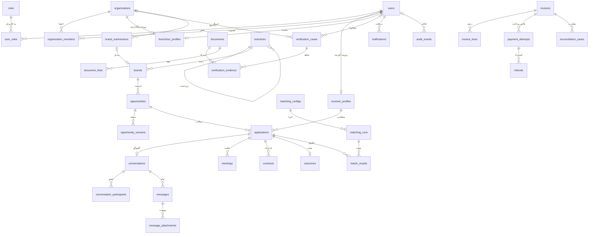

# مدل داده و طرح پایگاه‌داده فرانچایز پلاس

**این سند چیست:** طرح مرجع مدل دادهٔ نسخهٔ اول «فرانچایز پلاس» روی PostgreSQL و Prisma؛ شامل موجودیت‌ها، فیلدهای کلیدی، کلیدها، ایندکس‌ها، قیدهای یکتایی، قواعد حذف، نمونهٔ کد Prisma و نمودار ارتباط موجودیت‌ها. مخاطب آن Developer Agent و بازبین فنی است؛ مالک محصول از بخش‌های ۱، ۲ و ۱۴ استفاده می‌کند.

| مورد | مقدار |
|---|---|
| نسخهٔ آخرین مبنای commit‌شده | ۰.۱ |
| commit شامل این نسخه | `b010d316c03db7fd21ae0a9f9e08b15f41ea9324` |
| زمان commit سند | خروجی `git show -s --format=%ci b010d316c03db7fd21ae0a9f9e08b15f41ea9324`: `2026-11-25 15:24:14 +0330` |
| مبنای پذیرش مالک برای Phase 1 | `4002c70fef15ff9662e0db9e3356b44a12f48f3a`; خروجی `git show -s --format=%ci`: `2026-11-26 13:03:43 +0330` |
| snapshot فعلی `main` | `8655c1bebd3728c80e9b7b617dc1ee820d92fd9a`; خروجی `git show -s --format=%ci`: `2026-11-26 13:06:30 +0330` |
| وضعیت ویرایش این نوبت | پیش‌نویس محلی، commit‌نشده؛ نسخه و timestamp این ویرایش: **تأییدنشده** |
| وضعیت اجرای Phase 2 | فایل‌های پایهٔ schema/migration/seed/test در درخت کاری محلی وجود دارند؛ API و DB تولیدی نداریم؛ Compose اجرا نشده است. آزمون‌های DB قبلی روی PostgreSQL سیستمی بودند، نه Compose؛ این مرحله هیچ آزمون DB اجرا نمی‌کند. |
| پایگاه‌دادهٔ هدف | PostgreSQL 16 یا بالاتر |
| ORM | Prisma |
| واحد پول | ریال، عدد صحیح |
| منبع موجودیت‌ها | یادداشت خط مبنای فنی، بند ۴؛ Master Prompt، بندهای ۴ و ۶ و ۷ |
| سند مرتبط | `docs/TECHNICAL_ARCHITECTURE.md` |

## فهرست

۱. دامنه و مرزهای سند
۲. تصمیم‌ها، پیشنهادها، فرضیه‌ها و موارد نیازمند تأیید
۳. اصول مدل داده
۴. نمای کلی موجودیت‌ها و ERD
۵. مشخصات جدول‌ها به تفکیک ماژول
۶. بلوک‌های نمونهٔ Prisma
۷. قیدها، یکپارچگی و ایندکس‌های جزئی
۸. تراکنش‌ها و هم‌نوایی
۹. کارایی و راهبرد ایندکس
۱۰. نگهداشت، حذف و ناشناس‌سازی
۱۱. دادهٔ نمونه و seed
۱۲. نگاشت به کد فعلی مخزن
۱۳. مسیر مهاجرت و ترتیب ساخت
۱۴. ابهام‌های باز و تصمیم‌های بسته
۱۵. پیوست الف: فهرست enumها
۱۶. پیوست ب: ارجاع‌ها و تاریخچهٔ نسخه

---

## ۱. دامنه و مرزهای سند

**در دامنهٔ این سند:** ساختار جدول‌ها، نوع فیلدها، کلیدها، قیدها، ایندکس‌ها، سیاست حذف، مرزهای تراکنش، قواعد چندنقشی، احراز مستقل هر نقش و نگاشت به دادهٔ نمونهٔ فعلی.

**قفل دامنهٔ MVP به تأیید مالک:** فقط یک جریان انتها‌به‌انتها ساخته می‌شود: ثبت‌نام Applicant → احراز همان نقش → مشاهدهٔ فرصت‌های تأییدشده → ثبت درخواست → بررسی/تأیید تیم → گفت‌وگوی کنترل‌شده. فقط حداقل داده/جدول لازم برای حساب و نقش، احراز Applicant، فهرست منتشرشدهٔ فرصت‌ها، درخواست و تصمیم تیم، تخصیص لازم و گفت‌وگو/ممیزی مجاز است. ماژول خودخدمتی Franchisor و هر جدول/صفحهٔ خارج از این جریان در MVP ساخته نمی‌شود؛ نقش `FRANCHISOR` در seed صرفاً تعریف نقش است، نه مجوز ساخت ماژول آن.

**مدل بلندمدت و مرز پیاده‌سازی:** بخش‌های جدول‌محورِ این سند که به Franchisor، سازمان، پیشنهاد برند، تطبیق، CMS، مالی، مشاوره، تبلیغات یا قابلیت‌های دیگر می‌پردازند، طرح آینده‌اند و مجوز اجرای آن‌ها در MVP یا migration پایه نیستند. هر قابلیت بیرون از جریان MVP باید با تصمیم مالک و migration جداگانه بیاید.

**خارج از دامنهٔ MVP:** قیمت اشتراک، درصد/فرمول کمیسیون، سیاست استرداد، متن حقوقی، انتخاب/خرید میزبان و سرویس فایل، پرداخت زنده و طراحی/پیاده‌سازی API کامل.

**وضعیت پیاده‌سازی:** `lib/data.ts` همچنان دادهٔ ساختگی پیش‌نمایش است. فایل‌های پایهٔ Phase 2 شامل `prisma/schema.prisma`، migration، seed و تست SQL در درخت کاری محلی وجود دارند، اما full model این سند با آن foundation یکی نیست. API و DB تولیدی وجود ندارد؛ Compose اجرا نشده است. آزمون‌های DB قبلی روی PostgreSQL سیستمی بوده و در این مرحله تکرار نشده‌اند.

**بدهی‌های پذیرفته‌شدهٔ Phase 1 — باز و حل‌نشده** (همان موارد `docs/phase1/ACCEPTANCE_RECORD.md`):

1. **فونت Kalameh:** فایل و مجوز تجاری نهایی تحویل/تأیید نشده است؛ استفاده از fallback فعلی موقت می‌ماند.
2. **متن حقوقی و حریم خصوصی:** متن نهایی و تأیید حقوقی موجود نیست.
3. **قیمت‌گذاری مالی:** قیمت اشتراک، درصد/فرمول کمیسیون و سیاست استرداد تعیین نشده‌اند؛ هیچ عددی نباید حدس زده یا به‌عنوان قیمت واقعی نمایش داده شود.
4. **دادهٔ برندهای واقعی:** فرصت‌ها و برندهای فعلی نمونه‌اند؛ برند یا اطلاعات واقعی تأیید نشده است.
5. **میزبانی در ایران:** میزبان تولیدی، دامنه، دسترسی، پشتیبان و شرایط عملیاتی ایران انتخاب یا از داخل ایران آزموده نشده‌اند.

---

## ۲. تصمیم‌ها، پیشنهادها، فرضیه‌ها و موارد نیازمند تأیید

### ۲.۱ تصمیم‌های قطعی که مدل داده باید رعایت کند

| # | تصمیم | اثر مستقیم بر مدل |
|---|---|---|
| D-01 | بازار ایران، رابط فارسی و راست‌چین | زمان ذخیره‌شده به UTC و نمایش شمسی؛ متن‌ها فارسی؛ واحد پول ریال |
| D-02 | مدل Managed با بررسی مرکزی | صف کاری، تخصیص کارمند و ممیزی، جدول الزامی‌اند |
| D-03 | احراز هویت هر دو طرف | `verification_cases` مستقل از پروفایل و قابل تخصیص |
| D-04 | ایجاد برند رسمی و انتشار فرصت فقط با مدیر | `brands` و `opportunities` فقط از مسیر مدیر نوشته می‌شوند؛ پیشنهاد واگذارکننده در جدول جدا |
| D-05 | گفت‌وگو فقط پس از پذیرش | `conversations.application_id` یکتا و وابسته به درخواست پذیرفته‌شده |
| D-06 | دسته‌بندی صنایع از پایگاه‌داده | `industries` درخت داده، نه enum |
| D-07 | پرداخت زرین‌پال با تأیید سمت سرور و بدون تکرار اثر مالی | `payment_attempts.idempotency_key` یکتا؛ وضعیت مالی فقط از verify |
| D-08 | چهار جریان درآمدی بدون حدس قیمت | جدول‌های اشتراک، مشاوره و تبلیغات بدون مقدار پیش‌فرض قیمت |
| D-09 | هویت برند و پالت قفل‌شده | دارایی برند در `documents` با دستهٔ اختصاصی؛ رنگ در پایگاه‌داده نیست |
| D-10 | بدون ویدئوی واقعی، فقط جایگاه رسانه | جدول رسانهٔ صفحه در CMS به‌صورت ارجاع اختیاری؛ خارج از MVP |
| D-11 | یک حساب می‌تواند چند نقش فعال در `user_roles` داشته باشد؛ احراز و وضعیت هر نقش مستقل است و از یک نقش به نقش دیگر ارث نمی‌رسد | هر پروندهٔ احراز کاربر به همان واگذاری نقش مربوط می‌شود؛ شیوهٔ FK نهایی باید پیش از migration بازبینی شود |
| D-12 | نقش فعال باید صریح باشد و در هر درخواست API از سمت سرور اعتبارسنجی شود | مجوز بر مبنای نقش فعال + مالکیت پرونده + تخصیص؛ انتخاب UI مرجع مجوز نیست |
| D-13 | اگر یک شخص Applicant و Franchisor همان پرونده باشد، پرونده به کارشناس دیگری تخصیص می‌یابد و تعارض در audit ثبت می‌شود | تغییر نقش راه دسترسی به پروندهٔ رقیب نیست؛ آزمون منفی API لازم است |

### ۲.۲ پیشنهادهای این سند

| # | پیشنهاد | دلیل | جایگزین |
|---|---|---|---|
| P-01 | کلید اصلی UUID با ترجیح UUIDv7 | یکتایی توزیع‌شده و مرتب‌سازی زمانی | UUIDv4 یا شناسهٔ عددی |
| P-02 | شناسهٔ عمومی خوانا و جدا از کلید اصلی | جلوگیری از شمارش رکورد و افشای حجم | نمایش UUID |
| P-03 | نوع `BIGINT` برای همهٔ مبالغ ریالی | `Int` ۳۲ بیتی برای مبالغ ریالی سرریز می‌کند | `NUMERIC` با مقیاس صفر |
| P-04 | رمزنگاری فیلدهای هویتی در لایهٔ برنامه با hash جست‌وجوپذیر | کاهش اثر افشای پشتیبان | رمزنگاری دیسک تنها |
| P-05 | دفتر دوطرفهٔ ساده برای تراکنش‌های مالی | قابلیت تطبیق و حسابرسی | فقط وضعیت فاکتور |
| P-06 | ایندکس جزئی برای قیدهای «فعال» | قاعدهٔ کسب‌وکار در سطح داده اجرا می‌شود | کنترل فقط در کد |
| P-07 | نگهداشت پیشنهادی: OTP سی روز، outbox نود روز، match_result صد و هشتاد روز | کنترل حجم بدون از دست دادن ردگیری | نگهداشت یکسان |
| P-08 | جدول پیوند مدرک به‌جای ستون چندریختی در `documents` | قید یکتایی و ایندکس معنادار | ستون‌های nullable متعدد |
| P-09 | `citext` برای ایمیل یا نرمال‌سازی اجباری در برنامه | جلوگیری از تکرار حروف بزرگ و کوچک | مقایسهٔ حساس به حرف |
| P-10 | جدول `outcomes` جدا از `applications` | ثبت نتیجهٔ تجاری و مبنای درآمد بدون تغییر تاریخچهٔ درخواست | ستون‌های نتیجه در درخواست |

### ۲.۳ فرضیه‌ها

| # | فرضیه | آزمون | اگر نادرست باشد |
|---|---|---|---|
| H-01 | هر کاربر حداکثر یک پروندهٔ گیرنده دارد | بررسی جریان ثبت‌نام در Phase 2 | حذف قید یکتایی `receiver_profiles.user_id` |
| H-02 | هر واگذارکننده با یک سازمان یا یک کاربر نمایندگی می‌شود | بازبینی پرونده‌های واقعی در Phase 4 | جدول واسط چندسازمانی |
| H-03 | حجم مدارک در نسخهٔ اول کمتر از یک ترابایت است | سنجش پس از سه ماه بهره‌برداری | سیاست آرشیو سرد |
| H-04 | جست‌وجوی متنی ساده با `LIKE` و ایندکس کافی است | اندازه‌گیری جست‌وجوهای Phase 3 | افزودن `pg_trgm` یا موتور جست‌وجو |
| H-05 | یک درخواست فعال به ازای هر فرصت و متقاضی کافی است | بررسی نرخ درخواست تکراری | اجازهٔ چند درخواست با قید جدید |

### ۲.۴ نیازمند تأیید مالک

| موضوع | چرا مدل داده به آن وابسته است | گیت |
|---|---|---|
| پیاده‌سازی فیزیکی پیوند پروندهٔ احراز به ردیف `user_roles` | احراز باید به هر نقش جدا وابسته باشد؛ انتخاب FK/قید دقیق هنوز نیازمند بازبینی طراحی است و چندنقشی بودن دیگر تصمیم باز نیست | پیش از migration مربوط به احراز |
| معیار دقیق احراز و فهرست مدارک لازم | `verification_cases.level` و `documents.category` | پیش از Phase 4 |
| میزان اطلاعات مالی فرصت که عمومی می‌شود | فیلدهای قابل انتشار در `opportunities` | پیش از Phase 3 |
| فرمول و رویداد کمیسیون | `outcomes.commission_base_rial` و دفتر مالی | پیش از Phase 7 |
| قیمت پلن، مشاوره و تبلیغ | مقدار اولیهٔ جدول‌های درآمدی | پیش از Phase 7 |
| سیاست استرداد و مالیات | وضعیت‌های `refunds` و `invoices.tax_rial` | پیش از Phase 7 |
| مدت نگهداشت داده و متن حقوقی | سیاست حذف و ناشناس‌سازی | پیش از Phase 8 |
| ارائه‌دهندهٔ فضای ذخیره‌سازی | `documents.bucket` و مسیر کلید | پیش از Phase 4 |

---

## ۳. اصول مدل داده

### ۳.۱ قاعدهٔ پول

| قاعده | تعریف |
|---|---|
| واحد | ریال؛ هیچ فیلد پولی به تومان ذخیره نمی‌شود |
| نوع | عدد صحیح ۶۴ بیتی (`BIGINT` در PostgreSQL، `BigInt` در Prisma) |
| نام‌گذاری | پسوند `Rial` در نام فیلد، مثلاً `total_rial` |
| ممنوع | `float`، `double`، `real` و هر نوع اعشاری برای پول |
| دلیل فنی | `integer` ۳۲ بیتی سقف ۲٬۱۴۷٬۴۸۳٬۶۴۷ دارد؛ سرمایهٔ ۴ میلیارد تومانی معادل ۴۰٬۰۰۰٬۰۰۰٬۰۰۰ ریال است و سرریز می‌کند |
| علامت | مبالغ فاکتور و پرداخت نامنفی؛ بدهکار و بستانکار در دفتر با دو ستون جدا |
| نمایش | تبدیل به تومان فقط در لایهٔ نمایش انجام می‌شود (پیشنهاد؛ نیازمند تأیید) |
| گردکردن | در ذخیره‌سازی وجود ندارد؛ هر قاعدهٔ گردکردن باید پیش از Phase 7 توسط مالک تعیین شود |
| JSON | `BigInt` در پاسخ API به رشته تبدیل می‌شود تا دقت از دست نرود |

### ۳.۲ قاعدهٔ زمان

- همهٔ زمان‌ها `timestamptz(3)` و به وقت UTC ذخیره می‌شوند.
- تبدیل به تقویم شمسی فقط در لایهٔ نمایش انجام می‌شود. فایل `lib/fa.ts` در مخزن فعلی فقط ارقام را فارسی می‌کند و تبدیل تقویم انجام نمی‌دهد؛ افزودن تبدیل تقویم در Phase 2 لازم است.
- فیلدهای `created_at` و `updated_at` در همهٔ جدول‌های اصلی اجباری‌اند؛ `updated_at` با `@updatedAt` مدیریت می‌شود.
- تاریخ‌های کسب‌وکاری (انتشار، تصمیم، پرداخت) فیلد مستقل دارند و از `updated_at` استنتاج نمی‌شوند.

### ۳.۳ قاعدهٔ شناسه

| نوع | کاربرد | نمونه |
|---|---|---|
| `id` | کلید اصلی داخلی، UUID | `9f1c…` |
| `public_id` | شناسهٔ نمایشی یکتا برای پرونده‌ها | `FP-1042` |
| `slug` | مسیر عمومی صفحه | `kafe-arka` |
| `code` | کد پایدار و ماشین‌خوان | `SUPER_ADMIN` |

شناسهٔ عددی ترتیبی در مسیرهای عمومی استفاده نمی‌شود. تولید `public_id` باید اتمی و بدون افشای ترتیب حجم باشد (پیشنهاد P-02).

### ۳.۴ قاعدهٔ حذف

| سیاست | معنا | نمونه |
|---|---|---|
| A | حذف فیزیکی ممنوع؛ آرشیو یا حذف منطقی | مالی، ممیزی، قرارداد، تاریخچه |
| B | حذف نرم با `deleted_at`؛ بازیابی ممکن | کاربر، پرونده، برند، فرصت |
| C | حذف آبشاری ردیف‌های فرزند که بدون والد معنا ندارند | پیوست پیام، ردیف فاکتور |
| D | پاک‌سازی زمان‌بندی‌شده پس از پایان عمر | OTP، idempotency، outbox منتشرشده |

هیچ جدول مالی یا ممیزی حذف فیزیکی ندارد. حذف کاربر به معنای ناشناس‌سازی است، نه حذف ردیف.

### ۳.۵ طبقه‌بندی داده

| طبقه | نمونه | قاعدهٔ دسترسی | رمزنگاری |
|---|---|---|---|
| عمومی | عنوان فرصت، شهر، صنعت، خلاصهٔ منتشرشده | بدون احراز | در حالت سکون |
| داخلی | وضعیت پرونده، تخصیص کارمند | نقش کارمند با تخصیص | در حالت سکون |
| حساس | شمارهٔ ملی، منبع سرمایه، مدارک، پیام‌ها | نقش + مالکیت + مجوز موردی | برنامه‌ای برای فیلد هویتی |
| محدود | توکن نشست، کلید درگاه، راز زیرساخت | فقط سرویس | خارج از پایگاه‌داده |

شمارهٔ ملی به سه شکل نگهداری می‌شود: مقدار رمزنگاری‌شده، hash یکتا برای جلوگیری از تکرار، و چهار رقم آخر برای نمایش. مقدار خام در لاگ، پاسخ عمومی و فایل صادراتی نمی‌آید.

### ۳.۶ سازگاری نام‌گذاری با قرارداد API

| موضوع | در پایگاه‌داده | در قرارداد بیرونی | قاعدهٔ نگاشت |
|---|---|---|---|
| پسوند مبلغ | `_rial` | `_irr` در `docs/API_SPECIFICATION.md` | یک واحد (ریال)؛ نگاشت نام در لایهٔ API، بدون تبدیل مقدار |
| حروف وضعیت | حروف بزرگ مانند `UNDER_REVIEW` | حروف کوچک مانند `under_review` | نگاشت در لایهٔ ارائه، نه در چند نقطهٔ پراکنده |
| نوع مبلغ در JSON | `BIGINT` | رشتهٔ عددی | تبدیل در serializer تا دقت از دست نرود |
| نام فیلد | `lower_snake_case` | `lower_snake_case` | یکسان |

این تفاوت‌ها عمدی و محدود به مرز API هستند؛ هیچ‌کدام تغییر واحد پول یا تغییر معنای وضعیت نیست.

---

## ۴. نمای کلی موجودیت‌ها و ERD



---

## ۵. مشخصات جدول‌ها به تفکیک ماژول

راهنمای ستون‌ها: **کلید** شامل کلید اصلی و قیدهای یکتایی است؛ **حذف** حرف سیاست بخش ۳.۴ است.

### ۵.۱ هویت و دسترسی

| جدول | هدف | فیلدهای کلیدی | کلید و یکتایی | ایندکس‌ها | حذف |
|---|---|---|---|---|---|
| `users` | حساب یکتای هر شخص | `mobile_e164`، `email`، `password_hash`، `status`، `mobile_verified_at`، `last_login_at` | PK `id`؛ UQ `mobile_e164`؛ UQ `email` | `status`؛ `deleted_at` | B |
| `roles` | نقش‌های سیستمی و کد پایدار | `code`، `title_fa`، `is_system` | PK `id`؛ UQ `code` | — | A |
| `user_roles` | واگذاری مستقل هر نقش با تاریخ اعطا و ابطال؛ یک حساب می‌تواند چند نقش فعال داشته باشد | `user_id`، `role_id`، `granted_by_user_id`، `revoked_at` | PK `id`؛ UQ جزئی `user_id, role_id` با `revoked_at IS NULL` | `role_id`، `user_id` | A |
| `sessions` | نشست سمت سرور | `token_hash`، `user_id`، `expires_at`، `revoked_at`، `ip_hash` | PK `id`؛ UQ `token_hash` | `user_id, expires_at`؛ `expires_at` | C و D |
| `otp_challenges` | چالش کد یکبارمصرف | `mobile_e164`، `purpose`، `code_hash`، `attempts`، `expires_at`، `consumed_at` | PK `id` | `mobile_e164, created_at DESC`؛ `expires_at` | D |

**نکتهٔ قید:** یکتایی فعال `user_roles` جزئی است و در migration با SQL افزوده می‌شود؛ وضعیت فعلی اجرای آن فقط در شواهد محلی Phase 2 گزارش شده است.

**قاعدهٔ نقش در مدل:** چند ردیف فعال `user_roles` برای یک کاربر مجاز است، اما برای هر درخواست یک `active_role` باید صریح انتخاب و سمت سرور با واگذاری فعال همان کاربر تطبیق داده شود. وضعیت احراز هر نقش مستقل است و به نقش دیگر منتقل نمی‌شود. رابط کاربری منبع مجوز نیست. این‌ها شروط طراحی‌اند؛ در این نوبت migration/schema اجرایی تغییر نمی‌کند.

### ۵.۲ پرونده‌ها

| جدول | هدف | فیلدهای کلیدی | کلید و یکتایی | ایندکس‌ها | حذف |
|---|---|---|---|---|---|
| `receiver_profiles` | پروندهٔ گیرندهٔ نمایندگی | `user_id`، `national_id_enc`، `national_id_hash`، `budget_min_rial`، `budget_max_rial`، `capital_source`، `province_id`، `city_id`، `ready_in_days`، `completeness_pct`، `status` | PK `id`؛ UQ `user_id`؛ UQ `national_id_hash` | `province_id, city_id`؛ `status`؛ `budget_min_rial` | B |
| `organizations` | شخص حقوقی واگذارکننده | `legal_name`، `registration_no`، `org_type`، `province_id`، `city_id`، `verification_status` | PK `id`؛ UQ `registration_no` با چند NULL مجاز | `province_id, city_id`؛ `verification_status` | B |
| `organization_members` | عضویت کاربر در سازمان | `organization_id`، `user_id`، `role_in_org`، `is_primary`، `revoked_at` | PK `id`؛ UQ جزئی سه‌گانه با `revoked_at IS NULL` | `user_id` | C |
| `franchisor_profiles` | پروندهٔ واگذارکننده | `user_id`، `organization_id`، `brand_name`، `industry_id`، `years_active`، `branches_count`، `initial_investment_min_rial`، `initial_investment_max_rial`، `status` | PK `id`؛ UQ `user_id`؛ UQ `organization_id`؛ CHECK دقیقاً یکی | `industry_id`؛ `status` | B |
| `franchisor_target_regions` | مناطق موردنظر واگذارکننده | `franchisor_profile_id`، `region_id` | PK `id`؛ UQ دوگانه | `region_id` | C |

### ۵.۳ احراز هویت و مدارک

| جدول | هدف | فیلدهای کلیدی | کلید و یکتایی | ایندکس‌ها | حذف |
|---|---|---|---|---|---|
| `verification_cases` | پروندهٔ احراز مستقل برای یک نقش کاربر یا یک سازمان | `subject_type`، `subject_user_id`، `subject_user_role_id` (پیوند منطقی به واگذاری نقش)، `subject_organization_id`، `level`، `status`، `assigned_officer_id`، `decision_reason`، `decided_at`، `expires_at` | PK `id`؛ UQ جزئی برای همان واگذاری نقش/سازمان و سطح در وضعیت باز | `status, assigned_officer_id`؛ `subject_user_role_id, level`؛ `expires_at` | A |
| `verification_evidence` | پیوند مدرک به پروندهٔ احراز | `verification_case_id`، `document_id`، `evidence_type` | PK `id`؛ UQ دوگانه | `document_id` | C |
| `documents` | فرادادهٔ فایل خصوصی | `owner_user_id`، `organization_id`، `category`، `bucket`، `storage_key`، `mime_type`، `size_bytes`، `sha256`، `status`، `retention_until` | PK `id`؛ UQ `storage_key` | `owner_user_id`؛ `category, status`؛ `sha256` | B |
| `document_links` | پیوند مدرک به هر موجودیت | `document_id`، `entity_type`، `entity_id`، `linked_by_user_id` | PK `id`؛ UQ سه‌گانه | `entity_type, entity_id` | C |

**نکته:** `entity_id` در `document_links` کلید خارجی ندارد چون چندریختی است؛ اعتبار آن در لایهٔ برنامه و با ممیزی پیوند بررسی می‌شود.

**احراز مستقل هر نقش:** برای پروندهٔ کاربر، هدف احراز یک واگذاری مشخص `user_roles` است (مدل منطقی `subject_user_role_id` در ردیف بالا). تأیید Applicant، Franchisor یا هر نقش دیگری را تأیید نمی‌کند؛ برای نقش دیگر پرونده و تصمیم جدا لازم است. برای احراز سازمانی، هدف `subject_organization_id` است. قید فیزیکی و migration متناظر باید در بازبینی طراحی بعدی تثبیت شود؛ در این مرحله صرفاً سند تغییر کرده است.

### ۵.۴ تاکسونومی

| جدول | هدف | فیلدهای کلیدی | کلید و یکتایی | ایندکس‌ها | حذف |
|---|---|---|---|---|---|
| `industries` | درخت صنایع قابل مدیریت | `parent_id`، `slug`، `title_fa`، `sort_order`، `is_active` | PK `id`؛ UQ `slug` | `parent_id, sort_order`؛ `is_active` | A |
| `regions` | درخت استان، شهر و ناحیه | `parent_id`، `level`، `name_fa`، `slug`، `code` | PK `id`؛ UQ `parent_id, slug`؛ UQ `level, code` | `parent_id`؛ `level` | A |

حذف در این دو جدول ممنوع است؛ غیرفعال‌سازی با `is_active` انجام می‌شود تا ارجاع تاریخی نشکند.

### ۵.۵ کاتالوگ برند و فرصت

| جدول | هدف | فیلدهای کلیدی | کلید و یکتایی | ایندکس‌ها | حذف |
|---|---|---|---|---|---|
| `brands` | رکورد رسمی برند، فقط با ایجاد مدیر | `slug`، `name_fa`، `industry_id`، `owner_organization_id`، `logo_document_id`، `status`، `published_at`، `version` | PK `id`؛ UQ `slug` | `industry_id`؛ `status` | B |
| `brand_submissions` | پیشنهاد خصوصی برند توسط واگذارکننده | `submitted_by_user_id`، `organization_id`، `proposed_name_fa`، `industry_id`، `status`، `reviewed_by_user_id`، `decision_reason`، `brand_id` | PK `id` | `status, submitted_at`؛ `organization_id` | A |
| `opportunity_proposals` | پیشنهاد فرصت پیش از تأیید | `brand_submission_id`، `organization_id`، `industry_id`، `city_id`، `title`، `investment_min_rial`، `investment_max_rial`، `area_min_m2`، `area_max_m2`، `status` | PK `id` | `status`؛ `city_id` | A |
| `opportunities` | فرصت منتشرشده | `public_id`، `slug`، `brand_id`، `industry_id`، `province_id`، `city_id`، `title`، `status`، `published_at`، `published_version_no`، `version` | PK `id`؛ UQ `public_id`؛ UQ `slug` | `status, published_at DESC`؛ `industry_id`؛ `province_id, city_id`؛ `brand_id` | B |
| `opportunity_versions` | نسخهٔ منجمد و تغییرناپذیر فرصت | `opportunity_id`، `version_no`، `snapshot`، `changed_by_user_id`، `change_reason` | PK `id`؛ UQ `opportunity_id, version_no` | `created_at` | A |
| `opportunity_publication_events` | رویداد انتشار، توقف و بستن | `opportunity_id`، `action`، `actor_user_id`، `reason` | PK `id` | `opportunity_id, created_at` | A |

هیچ مسیر نوشتنی از واگذارکننده به `brands` یا `opportunities` وجود ندارد. `brand_submissions.brand_id` فقط پس از اقدام مدیر پر می‌شود.

### ۵.۶ درخواست و تطبیق

| جدول | هدف | فیلدهای کلیدی | کلید و یکتایی | ایندکس‌ها | حذف |
|---|---|---|---|---|---|
| `applications` | درخواست همکاری گیرنده | `public_id`، `opportunity_id`، `receiver_user_id`، `receiver_profile_id`، `status`، `submitted_at`، `decided_by_user_id`، `decision_reason` | PK `id`؛ UQ `public_id`؛ UQ جزئی فرصت و متقاضی در وضعیت فعال | `status, submitted_at`؛ `receiver_user_id`؛ `opportunity_id` | A |
| `application_events` | تاریخچهٔ تغییر وضعیت | `application_id`، `from_status`، `to_status`، `actor_user_id`، `reason`، `metadata` | PK `id` | `application_id, created_at` | A |
| `outcomes` | نتیجهٔ نهایی همکاری | `application_id`، `result`، `closed_at`، `commission_base_rial`، `recorded_by_user_id`، `notes` | PK `id`؛ UQ `application_id` | `result`؛ `closed_at` | A |
| `matching_configs` | نسخهٔ قواعد تطبیق | `code`، `version`، `weights`، `hard_filters`، `is_active` | PK `id`؛ UQ `code, version`؛ UQ جزئی نسخهٔ فعال | `is_active` | A |
| `matching_runs` | یک اجرای تطبیق | `config_id`، `triggered_by_user_id`، `scope`، `status`، `started_at`، `finished_at`، `stats` | PK `id` | `status, started_at`؛ `config_id` | B |
| `match_results` | نتیجهٔ توضیح‌پذیر برای هر جفت | `run_id`، `receiver_user_id`، `opportunity_id`، `score`، `reasons`، `rank` | PK `id`؛ UQ `run_id, receiver_user_id, opportunity_id` | `receiver_user_id, score DESC`؛ `opportunity_id, score DESC` | D |

`score` عدد صحیح ۰ تا ۱۰۰ است و `reasons` آرایهٔ JSON از عامل‌های قابل توضیح. هیچ نتیجه‌ای به رد خودکار منجر نمی‌شود.

`outcomes` از نظر گردش‌کار در گروه مذاکره است، اما مالکیت جدول به ماژول درخواست داده شده تا تغییر وضعیت درخواست و ثبت نتیجه در یک تراکنش انجام شود و مرز ماژول نشکند.

### ۵.۷ مذاکره و قرارداد

| جدول | هدف | فیلدهای کلیدی | کلید و یکتایی | ایندکس‌ها | حذف |
|---|---|---|---|---|---|
| `conversations` | گفت‌وگوی کنترل‌شده پس از پذیرش | `application_id`، `status`، `opened_at`، `opened_by_user_id`، `closed_at`، `last_message_at` | PK `id`؛ UQ `application_id` | `status, last_message_at` | A |
| `conversation_participants` | عضو و اجازهٔ نوشتن | `conversation_id`، `user_id`، `role`، `can_post`، `joined_at`، `left_at` | PK `id`؛ UQ جزئی دوگانه با `left_at IS NULL` | `user_id` | A |
| `messages` | پیام متن یا سیستمی | `conversation_id`، `sender_user_id`، `kind`، `body`، `visibility`، `client_message_id`، `edited_at`، `deleted_at` | PK `id`؛ UQ `conversation_id, client_message_id` | `conversation_id, created_at DESC`؛ `sender_user_id` | A |
| `message_attachments` | پیوند پیام به مدرک | `message_id`، `document_id` | PK `id`؛ UQ دوگانه | `document_id` | C |
| `meetings` | جلسهٔ حضوری یا آنلاین | `application_id`، `conversation_id`، `scheduled_at`، `duration_minutes`، `mode`، `status`، `created_by_user_id` | PK `id` | `application_id, scheduled_at`؛ `status` | B |
| `contracts` | قرارداد مرتبط با درخواست | `application_id`، `type`، `document_id`، `status`، `signed_at`، `effective_from`، `effective_to`، `amount_rial` | PK `id` | `application_id`؛ `status` | A |

`messages.deleted_at` حذف نرم محتوا با نگه‌داشتن ردیف است تا ممیزی و ترتیب گفت‌وگو حفظ شود. `contracts.status` تا تصویب قواعد حقوقی فقط ساختار دارد و هیچ اثر حقوقی از آن استنتاج نمی‌شود.

### ۵.۸ مالی

| جدول | هدف | فیلدهای کلیدی | کلید و یکتایی | ایندکس‌ها | حذف |
|---|---|---|---|---|---|
| `invoices` | فاکتور و جمع نهایی | `public_id`، `subject_type`، `subject_id`، `payer_user_id`، `payer_organization_id`، `status`، `subtotal_rial`، `discount_rial`، `tax_rial`، `total_rial`، `issued_at`، `due_at`، `paid_at` | PK `id`؛ UQ `public_id` | `status, due_at`؛ `payer_user_id` | A |
| `invoice_lines` | ردیف فاکتور | `invoice_id`، `description`، `quantity`، `unit_amount_rial`، `line_total_rial`، `kind` | PK `id` | `invoice_id` | A |
| `payment_attempts` | تلاش پرداخت و نتیجهٔ verify | `invoice_id`، `provider`، `amount_rial`، `status`، `idempotency_key`، `provider_authority`، `provider_ref_id`، `verified_at`، `failure_code` | PK `id`؛ UQ `idempotency_key`؛ UQ جزئی `provider, provider_authority` | `invoice_id, created_at`؛ `status` | A |
| `refunds` | استرداد و وضعیت آن | `payment_attempt_id`، `invoice_id`، `amount_rial`، `status`، `reason`، `requested_by_user_id`، `approved_by_user_id`، `processed_at` | PK `id` | `status, created_at`؛ `invoice_id` | A |
| `reconciliation_cases` | مغایرت پرداخت | `invoice_id`، `payment_attempt_id`، `type`، `status`، `assigned_to_user_id`، `resolution_note`، `resolved_at` | PK `id` | `status, created_at`؛ `assigned_to_user_id` | A |
| `ledger_entries` | دفتر دوطرفهٔ تراکنش | `entry_group_id`، `account_code`، `debit_rial`، `credit_rial`، `invoice_id`، `payment_attempt_id`، `refund_id`، `memo` | PK `id` | `entry_group_id`؛ `account_code, created_at`؛ `invoice_id` | A |

### ۵.۹ محصولات درآمدی

| جدول | هدف | فیلدهای کلیدی | کلید و یکتایی | ایندکس‌ها | حذف |
|---|---|---|---|---|---|
| `subscription_plans` | پلن اشتراک | `code`، `tier`، `title_fa`، `price_rial`، `period_months`، `features`، `is_active` | PK `id`؛ UQ `code` | `is_active` | A |
| `subscriptions` | اشتراک سازمان | `organization_id`، `plan_id`، `status`، `starts_at`، `ends_at`، `invoice_id` | PK `id`؛ UQ جزئی اشتراک فعال هر سازمان | `organization_id, status`؛ `ends_at` | A |
| `consulting_services` | خدمت مشاوره | `code`، `title_fa`، `duration_minutes`، `price_rial`، `is_active` | PK `id`؛ UQ `code` | `is_active` | A |
| `consulting_bookings` | رزرو مشاوره | `service_id`، `requester_user_id`، `consultant_user_id`، `status`، `scheduled_at`، `invoice_id`، `meeting_id` | PK `id` | `status, scheduled_at`؛ `requester_user_id` | A |
| `ad_slots` | جایگاه تبلیغ | `code`، `placement`، `title_fa`، `price_rial`، `capacity`، `is_active` | PK `id`؛ UQ `code` | `is_active` | A |
| `ad_campaigns` | کمپین تبلیغ | `slot_id`، `organization_id`، `status`، `starts_at`، `ends_at`، `invoice_id`، `creative_document_id` | PK `id` | `slot_id, starts_at`؛ `status` | A |

هیچ ردیفی با قیمت پیش‌فرض در seed این جدول‌ها ساخته نمی‌شود. `price_rial` بدون مقدار اولیه و فقط پس از تصویب مالک پر می‌شود.

### ۵.۱۰ کارکنان و ممیزی

| جدول | هدف | فیلدهای کلیدی | کلید و یکتایی | ایندکس‌ها | حذف |
|---|---|---|---|---|---|
| `staff_assignments` | تخصیص پرونده به کارمند | `user_id`، `scope_type`، `scope_id`، `role`، `assigned_by_user_id`، `unassigned_at` | PK `id`؛ UQ جزئی سه‌گانه با `unassigned_at IS NULL` | `user_id`؛ `scope_type, scope_id` | A |
| `access_grants` | مجوز موردی، دلیل‌دار و زمان‌دار | `user_id`، `resource_type`، `resource_id`، `permission`، `reason`، `expires_at`، `revoked_at`، `granted_by_user_id` | PK `id` | `user_id, resource_type, resource_id`؛ `expires_at` | A |
| `audit_events` | ثبت فقط‌افزودنی اقدام حساس | `actor_user_id`، `action`، `entity_type`، `entity_id`، `before`، `after`، `request_id`، `ip_hash` | PK `id` | `entity_type, entity_id, created_at DESC`؛ `actor_user_id, created_at DESC`؛ `action, created_at` | A |

`audit_events.actor_user_id` با `onDelete: SetNull` تعریف می‌شود تا ناشناس‌سازی کاربر، ممیزی را از بین نبرد. محتوای `before` و `after` فقط فیلدهای تغییرکردهٔ غیرحساس را نگه می‌دارد.

### ۵.۱۱ اعلان

| جدول | هدف | فیلدهای کلیدی | کلید و یکتایی | ایندکس‌ها | حذف |
|---|---|---|---|---|---|
| `notifications` | اعلان درون‌برنامه، پیامک یا ایمیل | `user_id`، `channel`، `template_code`، `payload`، `status`، `sent_at`، `read_at`، `dedupe_key` | PK `id`؛ UQ `dedupe_key` | `user_id, status, created_at DESC`؛ `status, created_at` | B و D |

`dedupe_key` از تکرار اعلان یکسان برای یک رخداد جلوگیری می‌کند. ارائه‌دهندهٔ پیامک هنوز انتخاب نشده؛ `channel` فقط نوع را مشخص می‌کند.

### ۵.۱۲ مدیریت محتوا

| جدول | هدف | فیلدهای کلیدی | کلید و یکتایی | ایندکس‌ها | حذف |
|---|---|---|---|---|---|
| `cms_pages` | صفحهٔ محتوایی عمومی | `slug`، `title_fa`، `status`، `seo_title`، `seo_description`، `published_at` | PK `id`؛ UQ `slug` | `status` | B |
| `cms_revisions` | نسخهٔ تغییرناپذیر محتوا | `page_id`، `revision_no`، `content`، `created_by_user_id` | PK `id`؛ UQ `page_id, revision_no` | `created_at` | A |
| `cms_blocks` | بلوک قابل استفادهٔ مجدد | `key`، `kind`، `content`، `is_active` | PK `id`؛ UQ `key` | `is_active` | B |

### ۵.۱۳ پلتفرم

| جدول | هدف | فیلدهای کلیدی | کلید و یکتایی | ایندکس‌ها | حذف |
|---|---|---|---|---|---|
| `outbox_events` | رخداد تراکنشی برای مصرف بیرونی | `aggregate_type`، `aggregate_id`، `event_type`، `payload`، `status`، `available_at`، `attempts`، `last_error`، `processed_at` | PK `id` | `status, available_at`؛ `aggregate_type, aggregate_id` | D |
| `idempotency_keys` | جلوگیری از تکرار اثر درخواست | `scope`، `key`، `request_hash`، `response_status`، `response_body`، `expires_at` | PK `id`؛ UQ `scope, key` | `expires_at` | D |

---

## ۶. بلوک‌های نمونهٔ Prisma

این بلوک‌ها قطعه‌هایی از مدل مرجع بلندمدت‌اند. فایل محلی `prisma/schema.prisma` در درخت کاری وجود دارد، اما فقط foundation محلی است و با این طرح کامل هم‌ارز نیست. فهرست مدل‌های این سند مجوز ساخت همهٔ آن‌ها در MVP نیست؛ فقط بخش حداقلی جریان MVP و با migration مجازِ جدا اعمال می‌شود.

### ۶.۱ پیکربندی، enumهای پایه و هویت

```prisma
datasource db {
  provider = "postgresql"
  url      = env("DATABASE_URL")
}

generator client {
  provider = "prisma-client-js"
}

enum UserStatus {
  PENDING_PHONE
  ACTIVE
  SUSPENDED
  CLOSED
}

enum ProfileStatus {
  DRAFT
  SUBMITTED
  VERIFIED
  REJECTED
}

enum OutboxStatus {
  PENDING
  PROCESSING
  PUBLISHED
  FAILED
  DEAD
}

model User {
  id               String        @id @default(uuid()) @db.Uuid
  publicId         String        @unique @map("public_id")
  mobileE164       String        @unique @map("mobile_e164")
  email            String?       @unique
  passwordHash     String?       @map("password_hash")
  status           UserStatus    @default(PENDING_PHONE)
  mobileVerifiedAt DateTime?     @map("mobile_verified_at") @db.Timestamptz(3)
  lastLoginAt      DateTime?     @map("last_login_at") @db.Timestamptz(3)
  createdAt        DateTime      @default(now()) @map("created_at") @db.Timestamptz(3)
  updatedAt        DateTime      @updatedAt @map("updated_at") @db.Timestamptz(3)
  deletedAt        DateTime?     @map("deleted_at") @db.Timestamptz(3)

  roles           UserRole[]
  sessions        Session[]
  receiverProfile ReceiverProfile?
  franchisorProfile FranchisorProfile?
  organizationMembers OrganizationMember[]

  @@index([status])
  @@index([deletedAt])
  @@map("users")
}

model Role {
  id        String     @id @default(uuid()) @db.Uuid
  code      String     @unique
  titleFa   String     @map("title_fa")
  isSystem  Boolean    @default(true) @map("is_system")
  createdAt DateTime   @default(now()) @map("created_at") @db.Timestamptz(3)
  userRoles UserRole[]

  @@map("roles")
}

model UserRole {
  id              String    @id @default(uuid()) @db.Uuid
  userId          String    @map("user_id") @db.Uuid
  roleId          String    @map("role_id") @db.Uuid
  grantedByUserId String?   @map("granted_by_user_id") @db.Uuid
  grantedAt       DateTime  @default(now()) @map("granted_at") @db.Timestamptz(3)
  revokedAt       DateTime? @map("revoked_at") @db.Timestamptz(3)

  user User @relation(fields: [userId], references: [id], onDelete: Restrict)
  role Role @relation(fields: [roleId], references: [id], onDelete: Restrict)

  @@index([userId, roleId])
  @@index([roleId])
  @@map("user_roles")
}

model Session {
  id            String    @id @default(uuid()) @db.Uuid
  userId        String    @map("user_id") @db.Uuid
  tokenHash     String    @unique @map("token_hash")
  ipHash        String?   @map("ip_hash")
  userAgent     String?   @map("user_agent") @db.VarChar(512)
  createdAt     DateTime  @default(now()) @map("created_at") @db.Timestamptz(3)
  lastSeenAt    DateTime  @default(now()) @map("last_seen_at") @db.Timestamptz(3)
  expiresAt     DateTime  @map("expires_at") @db.Timestamptz(3)
  revokedAt     DateTime? @map("revoked_at") @db.Timestamptz(3)
  revokedReason String?   @map("revoked_reason")

  user User @relation(fields: [userId], references: [id], onDelete: Cascade)

  @@index([userId, expiresAt])
  @@index([expiresAt])
  @@map("sessions")
}
```

### ۶.۲ پرونده‌ها

```prisma
enum CapitalSource {
  SAVINGS
  LOAN
  PARTNER
  FAMILY
  OTHER
  UNSPECIFIED
}

enum LocationTenure {
  OWNED
  LEASED
  UNDECIDED
}

enum OrganizationType {
  COMPANY
  INSTITUTE
  SOLE_PROPRIETOR
}

model ReceiverProfile {
  id              String         @id @default(uuid()) @db.Uuid
  userId          String         @unique @map("user_id") @db.Uuid
  displayName     String         @map("display_name")
  nationalIdEnc   String?        @map("national_id_enc")
  nationalIdHash  String?        @unique @map("national_id_hash")
  nationalIdLast4 String?        @map("national_id_last4") @db.Char(4)
  provinceId      String?        @map("province_id") @db.Uuid
  cityId          String?        @map("city_id") @db.Uuid
  capitalSource   CapitalSource  @default(UNSPECIFIED) @map("capital_source")
  budgetMinRial   BigInt?        @map("budget_min_rial")
  budgetMaxRial   BigInt?        @map("budget_max_rial")
  readyInDays     Int?           @map("ready_in_days")
  hasLocation     Boolean?       @map("has_location")
  locationTenure  LocationTenure? @map("location_tenure")
  locationAreaM2  Int?           @map("location_area_m2")
  completenessPct Int            @default(0) @map("completeness_pct")
  status          ProfileStatus  @default(DRAFT)
  createdAt       DateTime       @default(now()) @map("created_at") @db.Timestamptz(3)
  updatedAt       DateTime       @updatedAt @map("updated_at") @db.Timestamptz(3)
  deletedAt       DateTime?      @map("deleted_at") @db.Timestamptz(3)

  user User @relation(fields: [userId], references: [id], onDelete: Restrict)

  @@index([provinceId, cityId])
  @@index([status])
  @@index([budgetMinRial])
  @@map("receiver_profiles")
}

model Organization {
  id                 String           @id @default(uuid()) @db.Uuid
  legalName          String           @map("legal_name")
  registrationNo     String?          @map("registration_no")
  orgType            OrganizationType @map("org_type")
  provinceId         String?          @map("province_id") @db.Uuid
  cityId             String?          @map("city_id") @db.Uuid
  verificationStatus ProfileStatus    @default(DRAFT) @map("verification_status")
  createdAt          DateTime         @default(now()) @map("created_at") @db.Timestamptz(3)
  updatedAt          DateTime         @updatedAt @map("updated_at") @db.Timestamptz(3)
  deletedAt          DateTime?        @map("deleted_at") @db.Timestamptz(3)

  members        OrganizationMember[]
  franchisor     FranchisorProfile?

  @@unique([registrationNo])
  @@index([provinceId, cityId])
  @@index([verificationStatus])
  @@map("organizations")
}

model OrganizationMember {
  id             String    @id @default(uuid()) @db.Uuid
  organizationId String    @map("organization_id") @db.Uuid
  userId         String    @map("user_id") @db.Uuid
  roleInOrg      String    @map("role_in_org")
  isPrimary      Boolean   @default(false) @map("is_primary")
  joinedAt       DateTime  @default(now()) @map("joined_at") @db.Timestamptz(3)
  revokedAt      DateTime? @map("revoked_at") @db.Timestamptz(3)

  organization Organization @relation(fields: [organizationId], references: [id], onDelete: Cascade)
  user         User         @relation(fields: [userId], references: [id], onDelete: Restrict)

  @@index([userId])
  @@index([organizationId, revokedAt])
  @@map("organization_members")
}

model FranchisorProfile {
  id                        String        @id @default(uuid()) @db.Uuid
  userId                    String?       @unique @map("user_id") @db.Uuid
  organizationId           String?       @unique @map("organization_id") @db.Uuid
  brandName                 String        @map("brand_name")
  industryId                String?       @map("industry_id") @db.Uuid
  yearsActive               Int?          @map("years_active")
  branchesCount             Int?          @map("branches_count")
  initialInvestmentMinRial  BigInt?       @map("initial_investment_min_rial")
  initialInvestmentMaxRial  BigInt?       @map("initial_investment_max_rial")
  status                    ProfileStatus @default(DRAFT)
  createdAt                 DateTime      @default(now()) @map("created_at") @db.Timestamptz(3)
  updatedAt                 DateTime      @updatedAt @map("updated_at") @db.Timestamptz(3)
  deletedAt                 DateTime?     @map("deleted_at") @db.Timestamptz(3)

  user         User?         @relation(fields: [userId], references: [id], onDelete: Restrict)
  organization Organization? @relation(fields: [organizationId], references: [id], onDelete: Restrict)

  @@index([industryId])
  @@index([status])
  @@map("franchisor_profiles")
}
```

قید «دقیقاً یکی از `user_id` یا `organization_id`» در Prisma قابل بیان نیست و در migration با `CHECK` افزوده می‌شود (بخش ۷).

### ۶.۳ احراز، مدارک و تاکسونومی

```prisma
enum VerificationSubjectType {
  USER
  ORGANIZATION
  BRAND
}

enum VerificationLevel {
  IDENTITY
  BRAND
  OWNERSHIP
  FINANCIAL
}

enum VerificationStatus {
  OPEN
  IN_REVIEW
  NEEDS_INFO
  APPROVED
  REJECTED
  EXPIRED
}

enum DocumentCategory {
  IDENTITY
  OWNERSHIP
  LICENSE
  FINANCIAL
  CONTRACT
  BRAND_ASSET
  OTHER
}

model VerificationCase {
  id                    String                  @id @default(uuid()) @db.Uuid
  subjectType           VerificationSubjectType @map("subject_type")
  subjectUserId         String?                 @map("subject_user_id") @db.Uuid
  subjectOrganizationId String?                 @map("subject_organization_id") @db.Uuid
  level                 VerificationLevel
  status                VerificationStatus      @default(OPEN)
  assignedOfficerId     String?                 @map("assigned_officer_id") @db.Uuid
  decisionReason        String?                 @map("decision_reason")
  decidedAt             DateTime?               @map("decided_at") @db.Timestamptz(3)
  expiresAt             DateTime?               @map("expires_at") @db.Timestamptz(3)
  createdAt             DateTime                @default(now()) @map("created_at") @db.Timestamptz(3)
  updatedAt             DateTime                @updatedAt @map("updated_at") @db.Timestamptz(3)

  evidence VerificationEvidence[]

  @@index([status, assignedOfficerId])
  @@index([subjectType, subjectUserId])
  @@index([expiresAt])
  @@map("verification_cases")
}

model VerificationEvidence {
  id                String   @id @default(uuid()) @db.Uuid
  verificationCaseId String  @map("verification_case_id") @db.Uuid
  documentId        String   @map("document_id") @db.Uuid
  evidenceType      String   @map("evidence_type")
  createdAt         DateTime @default(now()) @map("created_at") @db.Timestamptz(3)

  verificationCase VerificationCase @relation(fields: [verificationCaseId], references: [id], onDelete: Cascade)

  @@unique([verificationCaseId, documentId])
  @@index([documentId])
  @@map("verification_evidence")
}

model Document {
  id             String          @id @default(uuid()) @db.Uuid
  ownerUserId    String          @map("owner_user_id") @db.Uuid
  organizationId String?         @map("organization_id") @db.Uuid
  category       DocumentCategory
  bucket         String
  storageKey     String          @unique @map("storage_key")
  fileName       String          @map("file_name")
  mimeType       String          @map("mime_type")
  sizeBytes      BigInt          @map("size_bytes")
  sha256         String
  status         String          @default("UPLOADED")
  retentionUntil DateTime?       @map("retention_until") @db.Timestamptz(3)
  createdAt      DateTime        @default(now()) @map("created_at") @db.Timestamptz(3)
  deletedAt      DateTime?       @map("deleted_at") @db.Timestamptz(3)

  @@index([ownerUserId])
  @@index([category, status])
  @@index([sha256])
  @@map("documents")
}

model Industry {
  id        String     @id @default(uuid()) @db.Uuid
  parentId  String?    @map("parent_id") @db.Uuid
  slug      String     @unique
  titleFa   String     @map("title_fa")
  sortOrder Int        @default(0) @map("sort_order")
  isActive  Boolean    @default(true) @map("is_active")
  createdAt DateTime   @default(now()) @map("created_at") @db.Timestamptz(3)

  parent   Industry?  @relation("IndustryTree", fields: [parentId], references: [id], onDelete: Restrict)
  children Industry[] @relation("IndustryTree")

  @@index([parentId, sortOrder])
  @@index([isActive])
  @@map("industries")
}

model Region {
  id       String     @id @default(uuid()) @db.Uuid
  parentId String?    @map("parent_id") @db.Uuid
  level    String
  nameFa   String     @map("name_fa")
  slug     String
  code     String?

  parent   Region?  @relation("RegionTree", fields: [parentId], references: [id], onDelete: Restrict)
  children Region[] @relation("RegionTree")

  @@unique([parentId, slug])
  @@index([level])
  @@map("regions")
}
```

### ۶.۴ برند، پیشنهاد و فرصت

```prisma
enum BrandStatus {
  DRAFT
  PUBLISHED
  SUSPENDED
  ARCHIVED
}

enum OpportunityStatus {
  DRAFT
  IN_REVIEW
  APPROVED
  SCHEDULED
  PUBLISHED
  PAUSED
  CLOSED
  ARCHIVED
}

model Brand {
  id                  String      @id @default(uuid()) @db.Uuid
  slug                String      @unique
  nameFa              String      @map("name_fa")
  nameEn              String?     @map("name_en")
  industryId          String      @map("industry_id") @db.Uuid
  ownerOrganizationId String?     @map("owner_organization_id") @db.Uuid
  logoDocumentId      String?     @map("logo_document_id") @db.Uuid
  description         String?
  status              BrandStatus @default(DRAFT)
  publishedAt         DateTime?   @map("published_at") @db.Timestamptz(3)
  version             Int         @default(1)
  createdByUserId     String      @map("created_by_user_id") @db.Uuid
  createdAt           DateTime    @default(now()) @map("created_at") @db.Timestamptz(3)
  updatedAt           DateTime    @updatedAt @map("updated_at") @db.Timestamptz(3)
  deletedAt           DateTime?   @map("deleted_at") @db.Timestamptz(3)

  opportunities Opportunity[]

  @@index([industryId])
  @@index([status])
  @@map("brands")
}

model BrandSubmission {
  id                 String    @id @default(uuid()) @db.Uuid
  submittedByUserId  String    @map("submitted_by_user_id") @db.Uuid
  organizationId     String    @map("organization_id") @db.Uuid
  proposedNameFa     String    @map("proposed_name_fa")
  industryId         String    @map("industry_id") @db.Uuid
  description        String?
  status             String    @default("SUBMITTED")
  reviewedByUserId   String?   @map("reviewed_by_user_id") @db.Uuid
  decisionReason     String?   @map("decision_reason")
  brandId            String?   @map("brand_id") @db.Uuid
  submittedAt        DateTime  @default(now()) @map("submitted_at") @db.Timestamptz(3)
  decidedAt          DateTime? @map("decided_at") @db.Timestamptz(3)

  @@index([status, submittedAt])
  @@index([organizationId])
  @@map("brand_submissions")
}

model Opportunity {
  id                 String            @id @default(uuid()) @db.Uuid
  publicId           String            @unique @map("public_id")
  slug               String            @unique
  brandId            String            @map("brand_id") @db.Uuid
  industryId         String            @map("industry_id") @db.Uuid
  provinceId         String            @map("province_id") @db.Uuid
  cityId             String            @map("city_id") @db.Uuid
  title              String
  summary            String
  status             OpportunityStatus @default(DRAFT)
  publishedAt        DateTime?         @map("published_at") @db.Timestamptz(3)
  closedAt           DateTime?         @map("closed_at") @db.Timestamptz(3)
  publishedVersionNo Int?              @map("published_version_no")
  version            Int               @default(1)
  createdByUserId    String            @map("created_by_user_id") @db.Uuid
  createdAt          DateTime          @default(now()) @map("created_at") @db.Timestamptz(3)
  updatedAt          DateTime          @updatedAt @map("updated_at") @db.Timestamptz(3)
  deletedAt          DateTime?         @map("deleted_at") @db.Timestamptz(3)

  brand    Brand              @relation(fields: [brandId], references: [id], onDelete: Restrict)
  versions OpportunityVersion[]

  @@index([status, publishedAt(sort: Desc)])
  @@index([industryId])
  @@index([provinceId, cityId])
  @@map("opportunities")
}

model OpportunityVersion {
  id              String   @id @default(uuid()) @db.Uuid
  opportunityId   String   @map("opportunity_id") @db.Uuid
  versionNo       Int      @map("version_no")
  snapshot        Json
  changedByUserId String   @map("changed_by_user_id") @db.Uuid
  changeReason    String?  @map("change_reason")
  createdAt       DateTime @default(now()) @map("created_at") @db.Timestamptz(3)

  opportunity Opportunity @relation(fields: [opportunityId], references: [id], onDelete: Restrict)

  @@unique([opportunityId, versionNo])
  @@map("opportunity_versions")
}
```

### ۶.۵ درخواست و تطبیق

```prisma
enum ApplicationStatus {
  DRAFT
  SUBMITTED
  UNDER_REVIEW
  INFO_REQUESTED
  ACCEPTED
  REJECTED
  WITHDRAWN
  CLOSED
}

model Application {
  id                 String            @id @default(uuid()) @db.Uuid
  publicId           String            @unique @map("public_id")
  opportunityId      String            @map("opportunity_id") @db.Uuid
  receiverUserId     String            @map("receiver_user_id") @db.Uuid
  receiverProfileId  String            @map("receiver_profile_id") @db.Uuid
  status             ApplicationStatus @default(DRAFT)
  submittedAt        DateTime?         @map("submitted_at") @db.Timestamptz(3)
  decidedAt          DateTime?         @map("decided_at") @db.Timestamptz(3)
  decidedByUserId    String?           @map("decided_by_user_id") @db.Uuid
  decisionReason     String?           @map("decision_reason")
  createdAt          DateTime          @default(now()) @map("created_at") @db.Timestamptz(3)
  updatedAt          DateTime          @updatedAt @map("updated_at") @db.Timestamptz(3)

  events       ApplicationEvent[]
  conversation Conversation?

  @@index([status, submittedAt])
  @@index([receiverUserId])
  @@index([opportunityId])
  @@map("applications")
}

model ApplicationEvent {
  id            String            @id @default(uuid()) @db.Uuid
  applicationId String            @map("application_id") @db.Uuid
  fromStatus    ApplicationStatus? @map("from_status")
  toStatus      ApplicationStatus @map("to_status")
  actorUserId   String?           @map("actor_user_id") @db.Uuid
  reason        String?
  metadata      Json?
  createdAt     DateTime          @default(now()) @map("created_at") @db.Timestamptz(3)

  application Application @relation(fields: [applicationId], references: [id], onDelete: Restrict)

  @@index([applicationId, createdAt])
  @@map("application_events")
}

model MatchingConfig {
  id          String   @id @default(uuid()) @db.Uuid
  code        String
  version     Int
  weights     Json
  hardFilters Json     @map("hard_filters")
  isActive    Boolean  @default(false) @map("is_active")
  createdAt   DateTime @default(now()) @map("created_at") @db.Timestamptz(3)

  runs MatchingRun[]

  @@unique([code, version])
  @@map("matching_configs")
}

model MatchingRun {
  id                String   @id @default(uuid()) @db.Uuid
  configId          String   @map("config_id") @db.Uuid
  triggeredByUserId String?  @map("triggered_by_user_id") @db.Uuid
  scope             Json?
  status            String   @default("QUEUED")
  startedAt         DateTime? @map("started_at") @db.Timestamptz(3)
  finishedAt        DateTime? @map("finished_at") @db.Timestamptz(3)
  stats             Json?
  createdAt         DateTime @default(now()) @map("created_at") @db.Timestamptz(3)

  config  MatchingConfig @relation(fields: [configId], references: [id], onDelete: Restrict)
  results MatchResult[]

  @@index([status, startedAt])
  @@map("matching_runs")
}

model MatchResult {
  id             String   @id @default(uuid()) @db.Uuid
  runId          String   @map("run_id") @db.Uuid
  receiverUserId String   @map("receiver_user_id") @db.Uuid
  opportunityId  String   @map("opportunity_id") @db.Uuid
  score          Int
  reasons        Json
  rank           Int?
  createdAt      DateTime @default(now()) @map("created_at") @db.Timestamptz(3)

  run MatchingRun @relation(fields: [runId], references: [id], onDelete: Cascade)

  @@unique([runId, receiverUserId, opportunityId])
  @@index([receiverUserId, score(sort: Desc)])
  @@index([opportunityId, score(sort: Desc)])
  @@map("match_results")
}
```

### ۶.۶ گفت‌وگو، جلسه، قرارداد و نتیجه

```prisma
model Conversation {
  id            String   @id @default(uuid()) @db.Uuid
  applicationId String   @unique @map("application_id") @db.Uuid
  status        String   @default("OPEN")
  openedAt      DateTime @default(now()) @map("opened_at") @db.Timestamptz(3)
  openedByUserId String  @map("opened_by_user_id") @db.Uuid
  closedAt      DateTime? @map("closed_at") @db.Timestamptz(3)
  closedReason  String?  @map("closed_reason")
  lastMessageAt DateTime? @map("last_message_at") @db.Timestamptz(3)

  application  Application             @relation(fields: [applicationId], references: [id], onDelete: Restrict)
  participants ConversationParticipant[]
  messages     Message[]

  @@index([status, lastMessageAt])
  @@map("conversations")
}

model ConversationParticipant {
  id             String    @id @default(uuid()) @db.Uuid
  conversationId String    @map("conversation_id") @db.Uuid
  userId         String    @map("user_id") @db.Uuid
  role           String
  canPost        Boolean   @default(true) @map("can_post")
  joinedAt       DateTime  @default(now()) @map("joined_at") @db.Timestamptz(3)
  leftAt         DateTime? @map("left_at") @db.Timestamptz(3)
  addedByUserId  String?   @map("added_by_user_id") @db.Uuid

  conversation Conversation @relation(fields: [conversationId], references: [id], onDelete: Cascade)

  @@index([userId])
  @@index([conversationId, leftAt])
  @@map("conversation_participants")
}

model Message {
  id              String    @id @default(uuid()) @db.Uuid
  conversationId  String    @map("conversation_id") @db.Uuid
  senderUserId    String    @map("sender_user_id") @db.Uuid
  kind            String    @default("TEXT")
  body            String
  visibility      String    @default("ALL")
  clientMessageId String?   @map("client_message_id")
  editedAt        DateTime? @map("edited_at") @db.Timestamptz(3)
  deletedAt       DateTime? @map("deleted_at") @db.Timestamptz(3)
  createdAt       DateTime  @default(now()) @map("created_at") @db.Timestamptz(3)

  conversation Conversation @relation(fields: [conversationId], references: [id], onDelete: Restrict)

  @@unique([conversationId, clientMessageId])
  @@index([conversationId, createdAt(sort: Desc)])
  @@index([senderUserId])
  @@map("messages")
}

model Meeting {
  id              String   @id @default(uuid()) @db.Uuid
  applicationId   String   @map("application_id") @db.Uuid
  conversationId  String?  @map("conversation_id") @db.Uuid
  scheduledAt     DateTime @map("scheduled_at") @db.Timestamptz(3)
  durationMinutes Int      @map("duration_minutes")
  mode            String
  status          String   @default("PROPOSED")
  createdByUserId String   @map("created_by_user_id") @db.Uuid
  createdAt       DateTime @default(now()) @map("created_at") @db.Timestamptz(3)

  @@index([applicationId, scheduledAt])
  @@index([status])
  @@map("meetings")
}

model Contract {
  id            String    @id @default(uuid()) @db.Uuid
  applicationId String    @map("application_id") @db.Uuid
  type          String
  documentId    String?   @map("document_id") @db.Uuid
  status        String    @default("DRAFT")
  signedAt      DateTime? @map("signed_at") @db.Timestamptz(3)
  effectiveFrom DateTime? @map("effective_from") @db.Timestamptz(3)
  effectiveTo   DateTime? @map("effective_to") @db.Timestamptz(3)
  amountRial    BigInt?   @map("amount_rial")
  createdAt     DateTime  @default(now()) @map("created_at") @db.Timestamptz(3)

  @@index([applicationId])
  @@index([status])
  @@map("contracts")
}

model Outcome {
  id                 String   @id @default(uuid()) @db.Uuid
  applicationId      String   @unique @map("application_id") @db.Uuid
  result             String
  closedAt           DateTime @map("closed_at") @db.Timestamptz(3)
  commissionBaseRial BigInt?  @map("commission_base_rial")
  recordedByUserId   String   @map("recorded_by_user_id") @db.Uuid
  notes              String?
  createdAt          DateTime @default(now()) @map("created_at") @db.Timestamptz(3)

  @@index([result])
  @@index([closedAt])
  @@map("outcomes")
}
```

### ۶.۷ مالی

```prisma
enum InvoiceStatus {
  DRAFT
  ISSUED
  PARTIALLY_PAID
  PAID
  VOID
  OVERDUE
}

enum PaymentStatus {
  CREATED
  REDIRECTED
  CALLBACK_RECEIVED
  VERIFIED
  FAILED
  CANCELED
  EXPIRED
}

model Invoice {
  id                  String        @id @default(uuid()) @db.Uuid
  publicId            String        @unique @map("public_id")
  subjectType         String        @map("subject_type")
  subjectId           String?       @map("subject_id") @db.Uuid
  payerUserId         String        @map("payer_user_id") @db.Uuid
  payerOrganizationId String?       @map("payer_organization_id") @db.Uuid
  status              InvoiceStatus @default(DRAFT)
  currency            String        @default("IRR") @db.Char(3)
  subtotalRial        BigInt        @map("subtotal_rial")
  discountRial        BigInt        @default(0) @map("discount_rial")
  taxRial             BigInt        @default(0) @map("tax_rial")
  totalRial           BigInt        @map("total_rial")
  issuedAt            DateTime?     @map("issued_at") @db.Timestamptz(3)
  dueAt               DateTime?     @map("due_at") @db.Timestamptz(3)
  paidAt              DateTime?     @map("paid_at") @db.Timestamptz(3)
  createdAt           DateTime      @default(now()) @map("created_at") @db.Timestamptz(3)
  updatedAt           DateTime      @updatedAt @map("updated_at") @db.Timestamptz(3)

  lines       InvoiceLine[]
  payments    PaymentAttempt[]
  refunds     Refund[]

  @@index([status, dueAt])
  @@index([payerUserId])
  @@map("invoices")
}

model InvoiceLine {
  id             String @id @default(uuid()) @db.Uuid
  invoiceId      String @map("invoice_id") @db.Uuid
  description    String
  quantity       Int    @default(1)
  unitAmountRial BigInt @map("unit_amount_rial")
  lineTotalRial  BigInt @map("line_total_rial")
  kind           String

  invoice Invoice @relation(fields: [invoiceId], references: [id], onDelete: Restrict)

  @@index([invoiceId])
  @@map("invoice_lines")
}

model PaymentAttempt {
  id               String        @id @default(uuid()) @db.Uuid
  invoiceId        String        @map("invoice_id") @db.Uuid
  provider         String        @default("ZARINPAL")
  amountRial       BigInt        @map("amount_rial")
  status           PaymentStatus @default(CREATED)
  idempotencyKey   String        @unique @map("idempotency_key")
  providerAuthority String?      @map("provider_authority")
  providerRefId    String?       @map("provider_ref_id")
  cardMask         String?       @map("card_mask") @db.VarChar(16)
  verifiedAt       DateTime?     @map("verified_at") @db.Timestamptz(3)
  failureCode      String?       @map("failure_code")
  createdAt        DateTime      @default(now()) @map("created_at") @db.Timestamptz(3)

  invoice Invoice  @relation(fields: [invoiceId], references: [id], onDelete: Restrict)
  refunds Refund[]

  @@index([invoiceId, createdAt])
  @@index([status])
  @@map("payment_attempts")
}

model Refund {
  id               String    @id @default(uuid()) @db.Uuid
  paymentAttemptId String    @map("payment_attempt_id") @db.Uuid
  invoiceId        String    @map("invoice_id") @db.Uuid
  amountRial       BigInt    @map("amount_rial")
  status           String    @default("REQUESTED")
  reason           String?
  requestedByUserId String   @map("requested_by_user_id") @db.Uuid
  approvedByUserId String?   @map("approved_by_user_id") @db.Uuid
  processedAt      DateTime? @map("processed_at") @db.Timestamptz(3)
  createdAt        DateTime  @default(now()) @map("created_at") @db.Timestamptz(3)

  payment PaymentAttempt @relation(fields: [paymentAttemptId], references: [id], onDelete: Restrict)
  invoice Invoice        @relation(fields: [invoiceId], references: [id], onDelete: Restrict)

  @@index([status, createdAt])
  @@index([invoiceId])
  @@map("refunds")
}
```

### ۶.۸ ممیزی، outbox و محتوا

```prisma
model AuditEvent {
  id          String   @id @default(uuid()) @db.Uuid
  actorUserId String?  @map("actor_user_id") @db.Uuid
  actorRole   String?  @map("actor_role")
  action      String
  entityType  String   @map("entity_type")
  entityId    String   @map("entity_id")
  before      Json?
  after       Json?
  requestId   String?  @map("request_id")
  ipHash      String?  @map("ip_hash")
  createdAt   DateTime @default(now()) @map("created_at") @db.Timestamptz(3)

  @@index([entityType, entityId, createdAt(sort: Desc)])
  @@index([actorUserId, createdAt(sort: Desc)])
  @@index([action, createdAt])
  @@map("audit_events")
}

model OutboxEvent {
  id            String       @id @default(uuid()) @db.Uuid
  aggregateType String       @map("aggregate_type")
  aggregateId   String       @map("aggregate_id") @db.Uuid
  eventType     String       @map("event_type")
  payload       Json
  status        OutboxStatus @default(PENDING)
  availableAt   DateTime     @default(now()) @map("available_at") @db.Timestamptz(3)
  attempts      Int          @default(0)
  lastError     String?      @map("last_error")
  processedAt   DateTime?    @map("processed_at") @db.Timestamptz(3)
  createdAt     DateTime     @default(now()) @map("created_at") @db.Timestamptz(3)

  @@index([status, availableAt])
  @@index([aggregateType, aggregateId])
  @@map("outbox_events")
}

model CmsPage {
  id             String    @id @default(uuid()) @db.Uuid
  slug           String    @unique
  titleFa        String    @map("title_fa")
  status         String    @default("DRAFT")
  seoTitle       String?   @map("seo_title")
  seoDescription String?   @map("seo_description")
  publishedAt    DateTime? @map("published_at") @db.Timestamptz(3)
  createdAt      DateTime  @default(now()) @map("created_at") @db.Timestamptz(3)
  updatedAt      DateTime  @updatedAt @map("updated_at") @db.Timestamptz(3)

  revisions CmsRevision[]

  @@index([status])
  @@map("cms_pages")
}

model CmsRevision {
  id              String   @id @default(uuid()) @db.Uuid
  pageId          String   @map("page_id") @db.Uuid
  revisionNo      Int      @map("revision_no")
  content         Json
  createdByUserId String   @map("created_by_user_id") @db.Uuid
  createdAt       DateTime @default(now()) @map("created_at") @db.Timestamptz(3)

  page CmsPage @relation(fields: [pageId], references: [id], onDelete: Restrict)

  @@unique([pageId, revisionNo])
  @@map("cms_revisions")
}
```

---

## ۷. قیدها، یکپارچگی و ایندکس‌های جزئی

Prisma بخشی از قیدهای این طرح را بیان نمی‌کند. این قیدها باید در migration دستی افزوده و در CI بررسی شوند.

### ۷.۱ یکتایی‌های جزئی

```sql
-- یک درخواست فعال برای هر فرصت و متقاضی
CREATE UNIQUE INDEX uq_application_active
  ON applications (opportunity_id, receiver_user_id)
  WHERE status IN ('SUBMITTED', 'UNDER_REVIEW', 'INFO_REQUESTED', 'ACCEPTED');

-- یک نسخهٔ فعال تطبیق برای هر کد
CREATE UNIQUE INDEX uq_matching_config_active
  ON matching_configs (code)
  WHERE is_active = true;

-- یک نقش فعال برای هر کاربر و نقش
CREATE UNIQUE INDEX uq_user_role_active
  ON user_roles (user_id, role_id)
  WHERE revoked_at IS NULL;

-- یک اشتراک فعال برای هر سازمان
CREATE UNIQUE INDEX uq_subscription_active
  ON subscriptions (organization_id)
  WHERE status IN ('TRIAL', 'ACTIVE', 'PAST_DUE');

-- یک پروندهٔ احراز باز برای هر کاربر و سطح
CREATE UNIQUE INDEX uq_verification_open_user
  ON verification_cases (subject_user_id, level)
  WHERE status IN ('OPEN', 'IN_REVIEW', 'NEEDS_INFO') AND subject_user_id IS NOT NULL;

-- یک پروندهٔ احراز باز برای هر سازمان و سطح
CREATE UNIQUE INDEX uq_verification_open_org
  ON verification_cases (subject_organization_id, level)
  WHERE status IN ('OPEN', 'IN_REVIEW', 'NEEDS_INFO') AND subject_organization_id IS NOT NULL;

-- یک عضویت فعال برای هر کاربر در سازمان
CREATE UNIQUE INDEX uq_org_member_active
  ON organization_members (organization_id, user_id, role_in_org)
  WHERE revoked_at IS NULL;

-- یک حضور فعال برای هر کاربر در گفت‌وگو
CREATE UNIQUE INDEX uq_conversation_participant_active
  ON conversation_participants (conversation_id, user_id)
  WHERE left_at IS NULL;

-- یک تخصیص فعال برای هر کارمند روی یک پرونده
CREATE UNIQUE INDEX uq_staff_assignment_active
  ON staff_assignments (scope_type, scope_id, user_id)
  WHERE unassigned_at IS NULL;
```

### ۷.۲ قیدهای CHECK

```sql
ALTER TABLE invoices
  ADD CONSTRAINT chk_invoice_total
  CHECK (total_rial = subtotal_rial - discount_rial + tax_rial);

ALTER TABLE invoices
  ADD CONSTRAINT chk_invoice_amounts_nonnegative
  CHECK (subtotal_rial >= 0 AND discount_rial >= 0 AND tax_rial >= 0 AND total_rial >= 0);

ALTER TABLE payment_attempts
  ADD CONSTRAINT chk_payment_amount_positive
  CHECK (amount_rial > 0);

ALTER TABLE receiver_profiles
  ADD CONSTRAINT chk_budget_range
  CHECK (budget_min_rial IS NULL OR budget_max_rial IS NULL OR budget_max_rial >= budget_min_rial);

ALTER TABLE franchisor_profiles
  ADD CONSTRAINT chk_franchisor_subject
  CHECK ((user_id IS NOT NULL)::int + (organization_id IS NOT NULL)::int = 1);

ALTER TABLE ledger_entries
  ADD CONSTRAINT chk_ledger_one_side
  CHECK ((debit_rial > 0 AND credit_rial = 0) OR (credit_rial > 0 AND debit_rial = 0));

ALTER TABLE match_results
  ADD CONSTRAINT chk_match_score
  CHECK (score BETWEEN 0 AND 100);
```

### ۷.۳ قواعد یکپارچگی بین جدول‌ها

| قاعده | نقطهٔ اجرا |
|---|---|
| گفت‌وگو فقط برای درخواست پذیرفته‌شده | سرویس + بررسی وضعیت در همان تراکنش |
| انتشار فرصت فقط با نقش مدیر | Guard در API و ممیزی رویداد انتشار |
| پرداخت فقط برای فاکتور معتبر و پرداخت‌نشده | قفل ردیف فاکتور و بررسی وضعیت |
| جمع دفتر متوازن در هر گروه | سرویس مالی و بررسی شبانه |
| حذف سازمان با فرصت فعال ممنوع | قید `Restrict` و بررسی سرویس |
| مدرک متصل به پروندهٔ احراز حذف نمی‌شود | سیاست A و بررسی در سرویس |

---

## ۸. تراکنش‌ها و هم‌نوایی

| عملیات | جدول‌های درگیر | مرز تراکنش | قفل و سطح |
|---|---|---|---|
| ارسال درخواست | `applications`، `application_events`، `outbox_events` | یک تراکنش | بررسی قید یکتایی فعال؛ Read Committed |
| پذیرش درخواست | `applications`، `application_events`، `conversations`، `conversation_participants`، `notifications`، `outbox_events` | یک تراکنش | قفل ردیف درخواست با `FOR UPDATE` |
| ثبت نتیجه | `outcomes`، `applications`، `application_events`، `outbox_events` | یک تراکنش | قفل درخواست |
| verify پرداخت | `payment_attempts`، `invoices`، `ledger_entries`، `outbox_events` | یک تراکنش | قفل فاکتور و تلاش پرداخت؛ بررسی idempotency |
| استرداد | `refunds`، `payment_attempts`، `ledger_entries`، `outbox_events` | یک تراکنش | قفل تلاش پرداخت |
| اجرای تطبیق | `matching_runs`، `match_results` | تراکنش دسته‌ای یا درج تدریجی با نشانگر پیشرفت | بدون قفل طولانی روی پرونده‌ها |
| انتشار فرصت | `opportunities`، `opportunity_versions`، `opportunity_publication_events`، `outbox_events` | یک تراکنش | قفل فرصت و افزایش نسخه |

**قواعد کلی:**

- تراکنش‌ها کوتاه‌اند؛ فراخوانی درگاه، ارسال پیامک و آپلود فایل داخل تراکنش پایگاه‌داده انجام نمی‌شود.
- هر عملیات مالی یک `idempotency_key` دارد و اثر آن یک‌بار ثبت می‌شود.
- افزایش نسخهٔ فرصت با `UPDATE … WHERE version = :expected` انجام می‌شود تا نوشتن هم‌زمان از دست نرود.
- سطح پیش‌فرض `Read Committed` است؛ `Serializable` فقط برای عملیات مالی حساس در صورت نیاز و با تلاش دوباره.

---

## ۹. کارایی و راهبرد ایندکس

| موضوع | راهبرد |
|---|---|
| صف بررسی | ایندکس ترکیبی `status, submitted_at` روی درخواست‌ها و پیشنهادها |
| فهرست عمومی | ایندکس `status, published_at DESC` و کش کوتاه‌مدت |
| جست‌وجوی برند | در نسخهٔ اول `LIKE` روی `name_fa`؛ افزودن `pg_trgm` در صورت نیاز (H-04) |
| پیام‌ها | ایندکس `conversation_id, created_at DESC` برای صفحه‌بندی معکوس |
| صف outbox | ایندکس `status, available_at` و پاک‌سازی دوره‌ای |
| گزارش مالی | ایندکس `payer_user_id` و `status, due_at`؛ گزارش سنگین روی replica در آینده |
| متن فارسی | تنظیم collation و بررسی ایندکس روی متن نرمال‌شده |

از ایندکس روی هر ستون به‌صورت پیش‌فرض پرهیز می‌شود؛ هر ایندکس هزینهٔ نوشتن دارد و باید به کوئری مشخص متصل باشد.

---

## ۱۰. نگهداشت، حذف و ناشناس‌سازی

| داده | نگهداشت پیشنهادی | مبنا | وضعیت |
|---|---|---|---|
| `otp_challenges` | سی روز | امنیت و عیب‌یابی | پیشنهاد |
| `sessions` منقضی | سی روز پس از انقضا | امنیت | پیشنهاد |
| `outbox_events` منتشرشده | نود روز | عیب‌یابی رخداد | پیشنهاد |
| `match_results` | صد و هشتاد روز | بازتولید تطبیق | پیشنهاد |
| `audit_events` | پنج سال | نیاز حسابرسی | نیازمند تأیید حقوقی |
| `invoices` و پرداخت‌ها | ده سال | الزام مالی احتمالی | نیازمند تأیید حقوقی |
| مدارک هویتی | تا پایان رابطه و دورهٔ قانونی | حریم خصوصی | نیازمند تأیید حقوقی |
| پیام‌ها | تا بستن پرونده و دورهٔ شکایت | اثبات مکاتبه | نیازمند تأیید حقوقی |

**رویهٔ ناشناس‌سازی کاربر:**

1. `users.status` به `CLOSED` و `deleted_at` پر شود؛ نتیجه: ورود مسدود.
2. شمارهٔ همراه و ایمیل با مقدار جانشین یکتا بازنویسی شود؛ نتیجه: عدم امکان تطبیق هویت.
3. فیلدهای هویتی پرونده پاک یا رمزنگاری‌شدهٔ غیرقابل بازیابی شوند؛ نتیجه: از دست رفتن ارزش هویتی.
4. ارجاع‌های مالی و ممیزی دست‌نخورده بمانند؛ نتیجه: گزارش مالی معتبر.
5. رخداد `user.anonymized` در outbox ثبت شود؛ نتیجه: هماهنگی سرویس‌های دیگر.

حذف فیزیکی ردیف کاربر انجام نمی‌شود چون کلیدهای خارجی مالی و ممیزی به آن وابسته‌اند.

---

## ۱۱. دادهٔ نمونه و seed

| قاعده | الزام |
|---|---|
| فهرست نقش‌ها | فقط `APPLICANT`، `FRANCHISOR`، `VERIFICATION_OFFICER`، `ADMIN` و `SUPER_ADMIN`؛ هیچ نقش seed دیگری افزوده نمی‌شود. |
| بدون حساب پیش‌فرض | seed هیچ کاربر، حساب مدیر یا Super Admin پیش‌فرض نمی‌سازد. نقش `SUPER_ADMIN` فقط تعریف نقش است. |
| گارد محیط | فقط اگر host در `DATABASE_URL` loopback (`127.0.0.1`، `::1` یا `localhost`) باشد و نام DB به `_dev` یا `_test` ختم شود اجرا شود؛ هر حالت دیگر باید fail-closed رد شود. |
| دامنهٔ MVP | وجود رکورد نقش `FRANCHISOR` اجازهٔ ساخت پروفایل/سازمان/صفحهٔ Franchisor یا دادهٔ کسب‌وکاری خارج از MVP نیست. |
| دادهٔ ساختگی | هیچ شمارهٔ ملی، موبایل، مدرک یا دادهٔ واقعی در seed قرار نمی‌گیرد؛ دادهٔ نمایشی `lib/data.ts` خودبه‌خود به DB seed نمی‌شود. |
| تکرارپذیری | ایجاد نقش‌ها idempotent باشد و اجرای دوباره نقش تکراری نسازد. |
| بدون راز | هیچ کلید، token یا رمز واقعی در seed یا خروجی آن چاپ نمی‌شود. |

اجرای seed فقط طبق گاردهای بالا و مسیر مستند `docs/phase2/DB_BOOTSTRAP.md` مجاز است. هیچ migration، seed یا DB در این مرحله اجرا نشده است؛ آزمون‌های محلی قبلی جایگزین گارد Compose/loopback یا پذیرش DB درون مخزن نیستند.

---

## ۱۲. نگاشت به کد فعلی مخزن

این نگاشت از پیش‌نمایش استاتیک Phase 1 به مدل هدف است؛ API واقعی ندارد. Foundation Prisma در working tree محلی وجود دارد، اما این نگاشت به معنی پیاده‌سازی کامل مدل یا مجوز افزودن ماژول‌های بیرون از MVP نیست.

| ساختار فعلی | جدول‌های معادل | تفاوت |
|---|---|---|
| `Opportunity` در `lib/data.ts` | `opportunities` + `brands` + `industries` + `regions` | در کد فعلی برند و صنعت و شهر رشتهٔ متنی‌اند؛ در مدل هدف، کلید خارجی |
| `receiverProfile` | `receiver_profiles` + `users` | بودجه در کد رشته است؛ در مدل هدف دو عدد ریالی |
| `myApplications` | `applications` + `application_events` | وضعیت در کد رشتهٔ نمایشی است؛ در مدل هدف enum |
| `adminQueue` | `applications`، `brand_submissions`، `verification_cases`، `staff_assignments` | صف واحد نمایشی به سه پروندهٔ مستقل تفکیک می‌شود |
| `chatMessages` | `messages` + `conversations` + `conversation_participants` | پیام سیستمی در مدل هدف `kind = SYSTEM` |
| `verificationTimeline` | `verification_cases` + `verification_evidence` | تاریخ‌های نمایشی به رویدادهای واقعی تبدیل می‌شوند |
| `industries` | `industries` | فهرست ثابت به درخت قابل مدیریت |

---

## ۱۳. مسیر مهاجرت و ترتیب ساخت

**مرز:** Foundation محلی در درخت کاری وجود دارد؛ این جدول برنامهٔ بازبینی/پذیرش آن است، نه گزارش اجرای گام‌ها. MVP به یک جریان محدود می‌ماند و هیچ جدول آینده صرفاً به‌دلیل حضور در بخش‌های دیگر این سند ساخته نمی‌شود.

| گام | کار | فاز | معیار پذیرش |
|---|---|---|---|
| ۱ | بازبینی foundation و schema فقط بر اساس جریان Applicant → احراز همان نقش → فرصت تأییدشده → درخواست → تصمیم تیم → گفت‌وگوی کنترل‌شده | Phase 2 | فهرست مدل‌های MVP و مدل‌های خارج از MVP روشن؛ `prisma validate` فقط با شاهد اجرا گزارش شود |
| ۲ | migration گاردشدهٔ MVP برای DB خالی در محیط مجاز dev/test | Phase 2 | دستور، کد خروج و DB هدف در گزارش قابل‌بازتولید؛ هیچ DB تولیدی استفاده نشود |
| ۳ | seed فقط پنج نقش مصوب، بدون حساب و بدون Super Admin پیش‌فرض | Phase 2 | تکرار seed idempotent؛ host loopback و suffix `_dev`/`_test`؛ رد آزمون منفی سایر مقصدها |
| ۴ | آزمون نقش فعال، احراز مستقل نقش، مالکیت/تخصیص و گفت‌وگو پس از تأیید | Phase 2 | API منفی و audit برای تعارض همان پرونده، با شاهد اجرایی |
| ۵ | Franchisor self-service و هر ماژول بعدی (matching، مالی، CMS، مشاوره، تبلیغات و غیره) | فازهای بعدی، با تأیید جدا | migration جداگانه، تصمیم دامنه و آزمون مستقل؛ خارج از MVP |

هیچ گام این جدول با این ویرایش سند اجرا نشده است. هر قابلیت بیرون از جریان MVP، migration جدا می‌خواهد؛ تغییر مخرب یا seed پیش‌فرض مجاز نیست.

---

## ۱۴. ابهام‌های باز و تصمیم‌های بسته

**Q-01 بسته شد:** مالک چندنقشی بودن حساب را تأیید کرده است؛ هر نقش جدا احراز می‌شود، نقش فعال صریح است، و تعارض Applicant/Franchisor در همان پرونده به کارشناس دیگر تخصیص می‌یابد و در ممیزی ثبت می‌شود (D-11 تا D-13). جزئیات پیاده‌سازی FK نقش-پروندهٔ احراز همچنان یک سؤال فنی جداست.

| # | ابهام | اثر | تصمیم‌گیرنده | گیت |
|---|---|---|---|---|
| Q-01 | **بسته:** یک حساب می‌تواند چند نقش داشته باشد؛ احراز هر نقش مستقل و تعارض همان پرونده طبق D-11 تا D-13 مدیریت می‌شود | نقش فعال، پیوند verification به role و audit | مالک | بسته؛ جزئیات FK در بازبینی فنی |
| Q-02 | فهرست دقیق مدارک احراز برای هر طرف | `documents.category` و سطح پرونده | مالک و کارشناس احراز | Phase 4 |
| Q-03 | کدام فیلد مالی فرصت عمومی می‌شود؟ | فیلدهای قابل انتشار | مالک محصول | Phase 3 |
| Q-04 | فرمول و رویداد معتبر کمیسیون | `outcomes.commission_base_rial` و دفتر | مالک و مشاور مالی | Phase 7 |
| Q-05 | قیمت پلن، مشاوره و تبلیغ | مقدار جدول‌های درآمدی | مالک محصول | Phase 7 |
| Q-06 | سیاست استرداد و مالیات | وضعیت‌های `refunds` و `tax_rial` | مالک و مشاور مالیاتی | Phase 7 |
| Q-07 | مدت نگهداشت مدارک و پیام‌ها | سیاست حذف و ناشناس‌سازی | مالک و مشاور حقوقی | Phase 8 |
| Q-08 | امکان چند پروندهٔ واگذارکننده برای یک سازمان | قید یکتایی `franchisor_profiles` | مالک محصول | Phase 4 |
| Q-09 | نیاز به چند سازمان برای یک کاربر | ساختار `organization_members` | مالک محصول | Phase 4 |
| Q-10 | الزام ثبت شمارهٔ ملی برای همهٔ نقش‌ها | فیلد اجباری یا اختیاری | مالک و مشاور حقوقی | Phase 4 |

---

## ۱۵. پیوست الف: فهرست enumها

| enum | مقادیر | وضعیت |
|---|---|---|
| `UserStatus` | `PENDING_PHONE`، `ACTIVE`، `SUSPENDED`، `CLOSED` | پیشنهاد |
| `ProfileStatus` | `DRAFT`، `SUBMITTED`، `VERIFIED`، `REJECTED` | پیشنهاد |
| `ApplicationStatus` | `DRAFT`، `SUBMITTED`، `UNDER_REVIEW`، `INFO_REQUESTED`، `ACCEPTED`، `REJECTED`، `WITHDRAWN`، `CLOSED` | پیشنهاد، نیازمند تأیید در Phase 5 |
| `VerificationStatus` | `OPEN`، `IN_REVIEW`، `NEEDS_INFO`، `APPROVED`، `REJECTED`، `EXPIRED` | پیشنهاد |
| `InvoiceStatus` | `DRAFT`، `ISSUED`، `PARTIALLY_PAID`، `PAID`، `VOID`، `OVERDUE` | پیشنهاد |
| `PaymentStatus` | `CREATED`، `REDIRECTED`، `CALLBACK_RECEIVED`، `VERIFIED`، `FAILED`، `CANCELED`، `EXPIRED` | پیشنهاد |
| `OutboxStatus` | `PENDING`، `PROCESSING`، `PUBLISHED`، `FAILED`، `DEAD` | پیشنهاد |
| `DocumentCategory` | `IDENTITY`، `OWNERSHIP`، `LICENSE`، `FINANCIAL`، `CONTRACT`، `BRAND_ASSET`، `OTHER` | پیشنهاد |
| `BrandStatus` | `DRAFT`، `PUBLISHED`، `SUSPENDED`، `ARCHIVED` | پیشنهاد |
| `OpportunityStatus` | `DRAFT`، `IN_REVIEW`، `APPROVED`، `SCHEDULED`، `PUBLISHED`، `PAUSED`، `CLOSED`، `ARCHIVED` | خط مبنا: انتشار فقط با مدیر |

این فهرست‌ها نقطهٔ شروع‌اند؛ هر تغییر وضعیت باید در `API_SPECIFICATION.md` و آزمون‌های Phase 5 تثبیت شود.

---

## ۱۶. پیوست ب: ارجاع‌ها و تاریخچهٔ نسخه

| منبع | کاربرد در این سند |
|---|---|
| `franchise-plus-platform/lib/data.ts` | شکل فعلی موجودیت‌ها و دادهٔ نمونه |
| `franchise-plus-platform/lib/fa.ts` | تبدیل ارقام؛ نبود تبدیل تقویم |
| `franchise-plus-platform/package.json` | وابستگی‌های Prisma و اسکریپت‌های DB در درخت کاری محلی؛ وضعیت آن commit نشده و اجرای DB در این نوبت انجام نشده است |
| `franchise-plus-platform/app/opportunities/[slug]/page.tsx` | نمایش جزئیات فرصت و فیلدهای عمومی |
| `franchise-plus-platform/app/panel/admin/page.tsx` | صف بررسی و وضعیت‌های نمایشی |
| `franchise-plus-platform/app/chat/page.tsx` | ساختار گفت‌وگوی کنترل‌شده |

| نسخه | زمان commit (خروجی `git show -s --format=%ci`) | تغییر | وضعیت |
|---|---|---|---|
| ۰.۱ | `2026-11-25 15:24:14 +0330` | ایجاد اولیهٔ مدل داده برای Phase 2؛ commit `b010d316c03db7fd21ae0a9f9e08b15f41ea9324` | آخرین نسخهٔ commit‌شده |
| تأییدنشده | تأییدنشده | اصلاحات محلی دربارهٔ MVP، چندنقشی، احراز مستقل و seed | پیش‌نویس؛ commit نشده |
