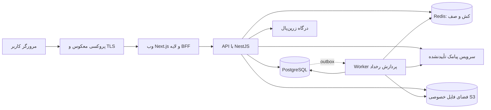
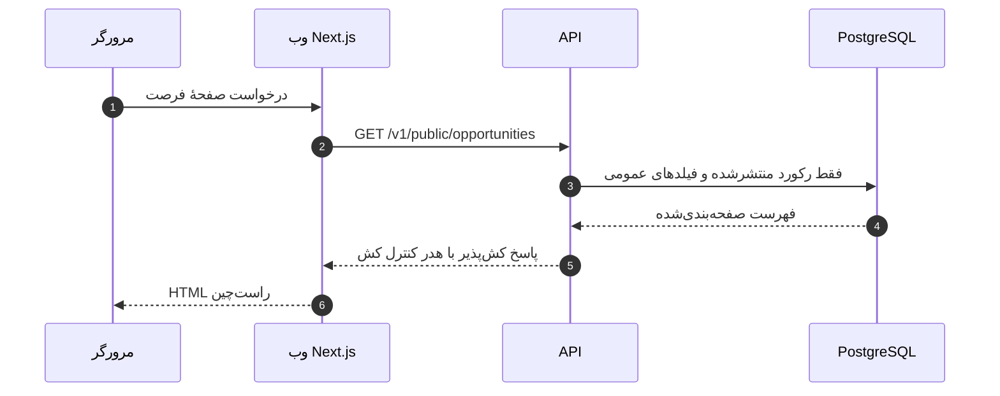
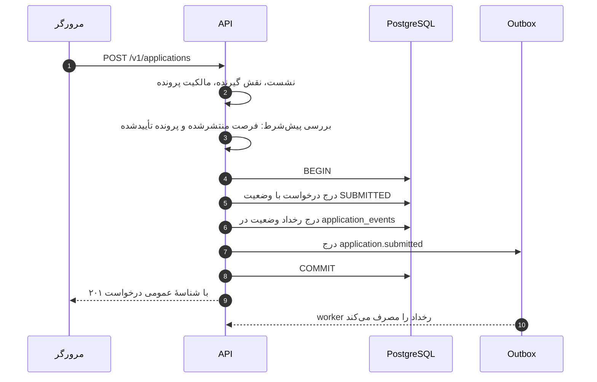
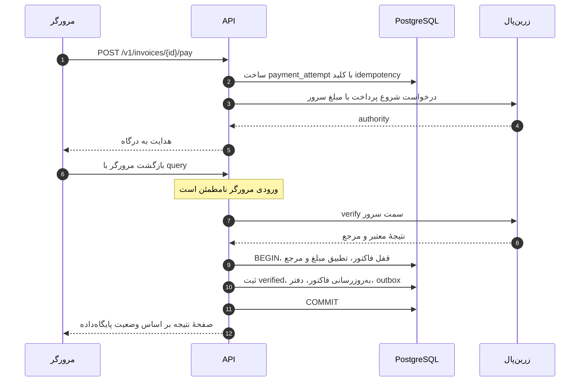

# معماری فنی فرانچایز پلاس — یکپارچهٔ ماژولار

**این سند چیست:** مرجع معماری فنی نسخهٔ اول «فرانچایز پلاس» برای Developer Agent، بازبین فنی و مالک محصول. پاسخ می‌دهد که سیستم از چه اجزایی ساخته می‌شود، مرز مسئولیت هر بخش کجاست، یک درخواست از مرورگر تا پایگاه‌داده چه مسیری طی می‌کند و کدام تصمیم‌ها هنوز گرفته نشده‌اند.

| مورد | مقدار |
|---|---|
| نسخه | ۰.۱ |
| تاریخ | ۴ آذر ۱۴۰۵ (۲۰۲۶-۱۱-۲۵) |
| وضعیت | طرح معماری برای Phase 2؛ **هیچ بخشی از لایهٔ سرور پیاده نشده است** |
| مخزن مرجع | `franchise-plus-platform/` |
| دامنهٔ سند | وب، API، داده، صف و رخداد، فایل، استقرار، CI، مشاهده‌پذیری، پشتیبان‌گیری، ریسک |
| خارج از دامنهٔ سند | قیمت‌گذاری، فرمول کمیسیون، سیاست استرداد، انتخاب ارائه‌دهنده، متن قرارداد حقوقی |
| سندهای مرتبط | `docs/DATABASE_SCHEMA.md` (همین مرحله)؛ `API_SPECIFICATION.md`، `SECURITY_AND_ACCESS_CONTROL.md`، `DEPLOYMENT_AND_OPERATIONS.md` (در انتظار نگارش) |

## فهرست

۱. وضعیت امروز و وضعیت هدف
۲. تصمیم‌ها، پیشنهادها، فرضیه‌ها و موارد نیازمند تأیید
۳. اصول معماری
۴. نمای کلی سیستم و مؤلفه‌ها
۵. مرز ماژول‌ها
۶. استک فنی و نقش هر جزء
۷. چرا در نسخهٔ اول ریزخدمت نیست
۸. جریان درخواست
۹. صف، رخداد و الگوی Outbox
۱۰. احراز هویت، نشست و مرزهای اعتماد
۱۱. انتخاب میزبان در ایران: معیارها و روش ارزیابی
۱۲. چرا Docker و توپولوژی استقرار
۱۳. یکپارچه‌سازی پیوسته و انتشار
۱۴. مشاهده‌پذیری
۱۵. پشتیبان‌گیری و بازیابی
۱۶. ریسک‌ها
۱۷. مسیر استخراج آیندهٔ سرویس‌ها
۱۸. نگاشت معماری به فازهای توسعه
۱۹. پیوست الف: ساختار پیشنهادی مخزن
۲۰. پیوست ب: واژه‌نامه
۲۱. پیوست ج: فایل‌های ارجاع‌شده و تاریخچهٔ نسخه

---

## ۱. وضعیت امروز و وضعیت هدف

مخزن فعلی یک **پیش‌نمایش طراحی Phase 1** است، نه یک محصول قابل اجرا در محیط واقعی. هر ادعایی دربارهٔ لایه‌های سرور در این سند «طرح» است، نه «گزارش انجام کار».

| لایه | وضعیت امروز | شاهد در مخزن | مرحلهٔ هدف |
|---|---|---|---|
| وب | ۹ صفحهٔ Next.js 15 با خروجی استاتیک و دادهٔ ساختگی | `package.json`، `next.config.mjs` (`output: 'export'`)، `app/` | Phase 1 (پیش‌نمایش) |
| API | وجود ندارد | هیچ پوشه یا ماژول سروری در مخزن نیست | Phase 2 |
| پایگاه‌داده | وجود ندارد؛ داده در فایل ثابت است | `lib/data.ts` | Phase 2 |
| طرح داده | فقط در سند `DATABASE_SCHEMA.md` | `prisma/schema.prisma` هنوز ساخته نشده است | Phase 2 |
| احراز هویت و نشست | وجود ندارد | — | Phase 2 |
| فایل خصوصی | وجود ندارد | — | Phase 4 |
| صف و رخداد | وجود ندارد | — | Phase 6 |
| پرداخت | وجود ندارد | — | Phase 7 |
| CI/CD | هیچ workflow در مخزن دیده نمی‌شود | نبود `.github/workflows/` | Phase 2 |
| مشاهده‌پذیری و پشتیبان‌گیری | وجود ندارد | — | Phase 8 |

**نکتهٔ معماری مهم:** خروجی استاتیک فعلی (`output: 'export'`) برای پیش‌نمایش طراحی مناسب است، اما پنل‌های وابسته به نشست کاربر و دادهٔ زنده با آن قابل ارائه نیستند. تغییر حالت اجرای وب، تصمیم Phase 2 است و در بخش ۲ به‌عنوان پیشنهاد ثبت شده است.

---

## ۲. تصمیم‌ها، پیشنهادها، فرضیه‌ها و موارد نیازمند تأیید

این سند چهار سطح تعهد را جدا نگه می‌دارد. خواننده باید بداند هر جمله چقدر الزام‌آور است.

### ۲.۱ تصمیم‌های قطعی محصول

این موارد توسط مالک محصول قفل شده‌اند و بدون اجازهٔ صریح او تغییر نمی‌کنند. معماری باید خود را با آن‌ها تطبیق دهد، نه برعکس.

| # | تصمیم قطعی | اثر معماری |
|---|---|---|
| D-01 | بازار نسخهٔ فعلی فقط ایران؛ رابط فقط فارسی و کاملاً راست‌چین | زمان‌مرز، تقویم نمایشی و واحد پول ایران‌محور؛ i18n چندزبانه در دامنهٔ نسخهٔ اول نیست |
| D-02 | مدل محصول Managed؛ بررسی مرکزی پرونده‌ها | صف‌های کاری کارمند، تخصیص پرونده و ممیزی، جزء الزامی معماری‌اند |
| D-03 | احراز هویت و اعتبارسنجی هر دو طرف | ماژول احراز و مدارک، مستقل از پروفایل‌ها |
| D-04 | ساخت برند رسمی و انتشار فرصت فقط با Admin/Super Admin | هیچ مسیر نوشتن مستقیم برای واگذارکننده در API وجود ندارد |
| D-05 | گفت‌وگو فقط پس از پذیرش درخواست و به‌صورت کنترل‌شده | بازشدن گفت‌وگو یک عملیات تراکنشی وابسته به تغییر وضعیت درخواست است |
| D-06 | دسته‌بندی صنایع سلسله‌مراتبی و قابل مدیریت از پایگاه‌داده | تاکسونومی، جدول داده است نه enum کد |
| D-07 | پرداخت با زرین‌پال؛ تأیید فقط سمت سرور و بدون اثر مالی تکراری | جریان پرداخت با verify سمت سرور، idempotency و تطبیق مبلغ |
| D-08 | چهار جریان درآمدی: کمیسیون، اشتراک، مشاوره، تبلیغات | هستهٔ مالی باید چندنوعی باشد؛ هیچ نرخ یا قیمتی در کد ثابت نمی‌شود |
| D-09 | هویت برند: نشان F با +، فونت Kalameh، پالت سرمه‌ای/استخوانی/برنز/سبز | لایهٔ وب باید توکن‌های طراحی را از منطق جدا نگه دارد؛ فونت از CDN بارگیری نمی‌شود |
| D-10 | بدون ویدئوی واقعی، Hero فقط جایگاه رسانه را پیش‌بینی می‌کند | هیچ مؤلفهٔ رسانه‌ای سنگین در معماری پیش‌فرض نیست |

منبع: Master Prompt مالک محصول و بند ۲ یادداشت خط مبنای فنی.

### ۲.۲ خط مبنای فنی تأییدشده برای برنامه‌ریزی

این‌ها در یادداشت خط مبنا تأیید شده‌اند، اما **انتخاب میزبان یا خرید سرویس نیستند**.

| حوزه | خط مبنا | مرز |
|---|---|---|
| معماری | یکپارچهٔ ماژولار؛ وب و API جداشدنی | استخراج آینده ممکن بماند |
| وب | Next.js + React + TypeScript | صفحات عمومی و پنل‌ها در یک پلتفرم |
| Backend | NestJS و REST نسخه‌بندی‌شده | مناسب ماژول، گردش‌کار و کنترل دسترسی |
| داده | PostgreSQL + Prisma migrations | تراکنش و ارتباط پرونده و مالی |
| صف/کش | Redis فقط برای صف یا کش در صورت نیاز | Redis منبع حقیقت نیست |
| فایل | S3-compatible خصوصی | URL امضاشدهٔ کوتاه‌عمر، بدون لینک عمومی |
| نشست | نشست سمت سرور و cookie امن؛ OTP برای تأیید شماره | توکن در `localStorage` نگهداری نمی‌شود |
| گفت‌وگو | REST برای نوشتن و تاریخچه؛ SSE یا polling برای رخداد تازه | WebSocket دوطرفه در نسخهٔ اول تعریف نشده |
| تطبیق | قواعد قطعی، نسخه‌دار و توضیح‌پذیر | بدون رد خودکار و بدون ادعای تضمین |
| پول | عدد صحیح با واحد ریال | اعشاری ممنوع |
| استقرار | Docker، قابل انتقال بین میزبان‌ها | میزبان و محل داده انتخاب نشده |

### ۲.۳ پیشنهادهای این سند

این‌ها انتخاب‌های فنی من به‌عنوان معمار است. اگر مالک یا بازبین فنی رد کند، جایگزین در ستون «جایگزین» آمده است.

| # | پیشنهاد | دلیل کوتاه | جایگزین |
|---|---|---|---|
| P-01 | وب به‌صورت سرور Node اجرا شود و نقش BFF سبک داشته باشد | انتقال cookie و فراخوانی API از سرور، بدون افشای توکن در مرورگر؛ CORS ساده‌تر | خروجی استاتیک برای صفحات عمومی + پنل‌های SPA |
| P-02 | ساختار مخزن، monorepo با `apps/web`، `apps/api`، `apps/worker` و `packages/contracts` | قرارداد مشترک تایپ و کاهش ناسازگاری وب و API | دو مخزن جدا با نسخه‌بندی بستهٔ قرارداد |
| P-03 | الگوی Transactional Outbox برای رخدادها | جلوگیری از گم‌شدن رخداد بین commit و ارسال | ارسال مستقیم به صف با ریسک ناسازگاری |
| P-04 | صف مبتنی بر Redis با کتابخانهٔ BullMQ | بالغ، ساده، سازگار با Redis موجود | صف مبتنی بر جدول PostgreSQL |
| P-05 | کلید اصلی UUID و ترجیح UUIDv7 برای مرتب‌سازی زمانی | کاهش پرش ایندکس و ساده‌سازی توزیع آینده | UUIDv4 یا شناسهٔ عددی ترتیبی |
| P-06 | شناسهٔ عمومی جداگانه مانند `FP-1042` برای پرونده‌ها | جلوگیری از افشای تعداد رکورد و شمارش‌پذیری | نمایش UUID در رابط |
| P-07 | اهداف پشتیبان‌گیری: RPO بیست‌وچهار ساعت و RTO چهار ساعت | تعادل هزینه و ریسک برای نسخهٔ اول؛ هم‌راستا با سند عملیات | بازهٔ کوتاه‌تر با آرشیو WAL و تأیید هزینه |
| P-08 | استقرار نسخهٔ اول روی یک میزبان با Docker Compose | سادگی عملیاتی و بازگشت سریع؛ ریزخدمت و Kubernetes لازم نیست | چند میزبان با orchestrator |
| P-09 | CI با GitHub Actions و جایگزین خودمیزبان در صورت محدودیت دسترسی | خط لولهٔ استاندارد و قابل بازبینی | GitLab CI خودمیزبان یا Gitea با runner |
| P-10 | ثبت رخدادهای دامنه در جدول `outbox_events` و مصرف idempotent | تحویل حداقل یک‌بار با اثر یک‌بار | تحویل دقیقاً یک‌بار با قفل توزیع‌شده |
| P-11 | رمزنگاری فیلدهای هویتی حساس در لایهٔ برنامه | کاهش اثر افشای نسخهٔ پشتیبان | اتکا به رمزنگاری دیسک میزبان |
| P-12 | پوشش تست حداقلی ۸۰٪ برای ماژول‌های مالی و دسترسی | این دو ماژول بیشترین هزینهٔ خطا را دارند | آستانهٔ یکسان برای همهٔ ماژول‌ها |

### ۲.۴ فرضیه‌ها

فرضیه، جمله‌ای است که هنوز آزموده نشده و اگر نادرست باشد، معماری تغییر می‌کند.

| # | فرضیه | چگونه آزموده می‌شود | اگر نادرست باشد |
|---|---|---|---|
| H-01 | حجم نسخهٔ اول در محدودهٔ یک میزبان قابل اجراست | آزمون بار ۲۴ ساعته و اندازه‌گیری هم‌زمانی واقعی پیش از انتشار | جداسازی پایگاه‌داده یا افزودن میزبان |
| H-02 | تأخیر شبکهٔ داخلی برای تجربهٔ پنل کافی است | اندازه‌گیری از سه شبکهٔ مختلف ایران در محیط آزمون | کش لبه‌ای یا تغییر توپولوژی |
| H-03 | کارمندان با تعداد کم و صف‌های ساده کار می‌کنند | بازبینی جریان کاری در Phase 5 با تیم واقعی | صف پیشرفته و تخصیص خودکار |
| H-04 | دسترسی به سرویس CI و مخزن از شبکهٔ کاری توسعه‌دهنده پایدار است | آزمون عملی پیش از Phase 2 | CI خودمیزبان |
| H-05 | نیازی به جست‌وجوی متنی سنگین نیست | سنجش تعداد و پیچیدگی جست‌وجوها در Phase 3 | افزودن موتور جست‌وجوی جدا |

### ۲.۵ نیازمند تأیید مالک

| موضوع | چرا معماری به آن وابسته است | گیت | پیش‌فرض موقت |
|---|---|---|---|
| ارائه‌دهندهٔ میزبان و محل داده | تأخیر، پشتیبان، انطباق و هزینه | پیش از Phase 2 | هیچ؛ ارزیابی طبق بخش ۱۱ |
| ارائه‌دهندهٔ پیامک و OTP | نرخ تحویل و هزینه | پیش از Phase 2 | پیمانهٔ انتزاعی پیامک با mock |
| دامنه و گواهی TLS | نشست امن و cookie | پیش از Phase 2 | دامنهٔ آزمایشی |
| بودجهٔ زیرساخت و پشتیبان | تعیین RPO/RTO و سقف ذخیره‌سازی | پیش از Phase 2 | اهداف P-07 |
| فرمول کمیسیون و رویداد معتبر | طراحی دفتر مالی و فاکتور | پیش از Phase 7 | هیچ نرخی در کد قرار نمی‌گیرد |
| قیمت پلن، مشاوره و تبلیغات | seed و نمایش عمومی | پیش از Phase 7 | بدون دادهٔ قیمت |
| سیاست استرداد و مالیات | وضعیت‌های refund و سند مالی | پیش از Phase 7 | فقط ساختار، بدون قاعده |
| مدت نگهداشت داده و متن حقوقی | سیاست حذف و ناشناس‌سازی | پیش از Phase 8 | پیشنهاد بخش ۱۵ |
| کلید و قرارداد زرین‌پال | اتصال درگاه | پیش از Phase 7 | sandbox |
| فایل نهایی لوگو و فونت Kalameh با مجوز | بارگذاری دارایی برند | پیش از انتشار عمومی | fallback خودمیزبان |

---

## ۳. اصول معماری

| اصل | معنا در این پروژه | چگونه اجرا می‌شود |
|---|---|---|
| A-01 مرز ماژول مقدم بر سرعت | هر جدول یک مالک دارد؛ ماژول دیگر فقط از واسط عمومی استفاده می‌کند | بازبینی کد و قاعدهٔ مسیر import |
| A-02 پایگاه‌داده منبع حقیقت | وضعیت پرونده، پرداخت و دسترسی فقط در PostgreSQL معتبر است | Redis فقط کش، صف و محدودسازی نرخ |
| A-03 تراکنش کوتاه، رخداد پایدار | عملیات تجاری در یک تراکنش؛ انتشار رخداد از outbox | بازبینی use caseهای نوشتن |
| A-04 امنیت در API، نه در رابط | هر درخواست مجوز خود را دوباره بررسی می‌کند | Guard و Policy در NestJS |
| A-05 همه‌چیز قابل ردیابی | هر تغییر حساس، ممیزی و شناسهٔ درخواست دارد | `audit_events` و لاگ ساختاریافته |
| A-06 قابل انتقال بودن | هیچ وابستگی سخت به یک میزبان خاص | Docker، S3-compatible، پیکربندی محیطی |

---

## ۴. نمای کلی سیستم و مؤلفه‌ها



| مؤلفه | فناوری | مسئولیت | چه چیزی نیست |
|---|---|---|---|
| وب | Next.js 15، React 19، TypeScript | رندر صفحات، فرم‌ها، دسترس‌پذیری، RTL، انتقال نشست | محل قاعدهٔ کسب‌وکار یا تصمیم دسترسی |
| API | NestJS، REST نسخه‌بندی‌شده | اعتبارسنجی، مجوز، گردش‌کار، تراکنش، انتشار رخداد | لایهٔ نمایش |
| پایگاه‌داده | PostgreSQL 16 یا بالاتر | منبع حقیقت داده و وضعیت | انبار تحلیل یا جست‌وجوی متنی سنگین |
| ORM | Prisma | مدل، migration، کوئری تایپ‌دار | جایگزین طراحی ایندکس یا SQL دستی |
| کش و صف | Redis | کش کوتاه‌عمر، صف کار، محدودسازی نرخ | نگهداری وضعیت پایدار |
| فایل | S3-compatible خصوصی | مدارک، لوگو، پیوست | میزبانی عمومی تصویر |
| Worker | فرایند Node جدا | مصرف outbox، اعلان، پاکسازی، تطبیق دوره‌ای | مسیر درخواست کاربر |
| پروکسی معکوس | Nginx یا Caddy | TLS، هدرها، محدودسازی نرخ لبه | احراز هویت |
| درگاه پرداخت | زرین‌پال | دریافت وجه و verify | منبع حقیقت وضعیت مالی داخلی |

---

## ۵. مرز ماژول‌ها

### ۵.۱ قاعدهٔ کلی

یکپارچهٔ ماژولار یعنی **یک استقرار، چند ماژول با مرز روشن**. مرزها در کد و در مالکیت داده تعریف می‌شوند، نه در نمودار.

| قاعده | تعریف | نقض رایج |
|---|---|---|
| R-01 | هر جدول دقیقاً یک ماژول مالک دارد | join مستقیم بین جدول‌های دو ماژول |
| R-02 | ماژول فقط از `public.ts` ماژول دیگر import می‌کند | import از مسیر داخلی `infra/` |
| R-03 | ارتباط تغییردهنده با رخداد دامنه انجام می‌شود | فراخوانی هم‌زمان چند ماژول در یک use case |
| R-04 | هیچ ماژولی به جدول ماژول دیگر کوئری نمی‌زند | استفادهٔ مشترک از repository |
| R-05 | هستهٔ مشترک حداقلی است: پول، شناسه، زمان، خطا | رشد «utils» عمومی |
| R-06 | وابستگی یک‌طرفه و بدون چرخه | A به B و B به A |

### ۵.۲ فهرست ماژول‌ها

| شناسه | ماژول | مسئولیت | جدول‌های تحت مالکیت | کاندید استخراج |
|---|---|---|---|---|
| M00 | Platform | outbox، idempotency، سلامت، پیکربندی | `outbox_events`، `idempotency_keys` | آخر |
| M01 | Identity & Access | حساب، نقش، نشست، OTP | `users`، `roles`، `user_roles`، `sessions`، `otp_challenges` | متوسط |
| M02 | Profiles | پروندهٔ گیرنده، سازمان، پروندهٔ واگذارکننده | `receiver_profiles`، `organizations`، `organization_members`، `franchisor_profiles`، `franchisor_target_regions` | کم |
| M03 | Verification & Documents | احراز، مدارک، دسترسی به فایل | `verification_cases`، `verification_evidence`، `documents`، `document_links` | زیاد |
| M04 | Taxonomy | صنایع و مناطق | `industries`، `regions` | متوسط |
| M05 | Brand Catalog | برند رسمی، پیشنهاد برند، فرصت، نسخه و انتشار | `brands`، `brand_submissions`، `opportunity_proposals`، `opportunities`، `opportunity_versions`، `opportunity_publication_events` | متوسط |
| M06 | Applications | درخواست همکاری، تاریخچهٔ وضعیت و نتیجهٔ نهایی | `applications`، `application_events`، `outcomes` | متوسط |
| M07 | Matching | پیکربندی، اجرا و نتیجهٔ تطبیق | `matching_configs`، `matching_runs`، `match_results` | زیاد |
| M08 | Messaging & Negotiation | گفت‌وگو، پیام، پیوست، جلسه و قرارداد | `conversations`، `conversation_participants`، `messages`، `message_attachments`، `meetings`، `contracts` | زیاد |
| M09 | Billing | فاکتور، پرداخت، استرداد، مغایرت، دفتر | `invoices`، `invoice_lines`، `payment_attempts`، `refunds`، `reconciliation_cases`، `ledger_entries` | متوسط |
| M10 | Revenue Products | اشتراک، مشاوره، تبلیغات | `subscription_plans`، `subscriptions`، `consulting_services`، `consulting_bookings`، `ad_slots`، `ad_campaigns` | متوسط |
| M11 | Staff & Audit | تخصیص کارمند، مجوز موردی، ممیزی | `staff_assignments`، `access_grants`، `audit_events` | کم |
| M12 | Notifications | اعلان درون‌برنامه و پیامک | `notifications` | زیاد |
| M13 | CMS | صفحات محتوایی و نسخه‌ها | `cms_pages`، `cms_revisions`، `cms_blocks` | متوسط |

### ۵.۳ جهت وابستگی

- M05 به M04 و M03 وابسته است؛ M06 به M05 و M02؛ M07 به M06، M05، M02 و M04؛ M08 به M06؛ M09 به M06 فقط از طریق رخداد؛ M10 به M09؛ M11 به همهٔ ماژول‌های دارای پرونده؛ M12 به رخداد همهٔ ماژول‌ها.
- M09 نباید جدول `applications` یا `outcomes` را مستقیم بخواند. مبنای کمیسیون از رخداد `application.outcome_recorded` و واسط عمومی M06 می‌آید.
- M03 مالک دسترسی به فایل است؛ هیچ ماژولی URL ذخیره‌سازی را مستقیم به کاربر نمی‌دهد.

**نمونهٔ اجرای قاعده در کد:** در `apps/api/eslint.config.mjs` الگوی `no-restricted-imports` روی `src/modules/*/infra/**` و `src/modules/*/internal/**` تنظیم می‌شود تا فقط مسیر عمومی هر ماژول قابل import باشد. این پیکربندی در Phase 2 ساخته می‌شود.

### ۵.۴ ساختار داخلی هر ماژول (پیشنهاد P-02)

```text
apps/api/src/modules/applications/
  api/            controller، DTO، mapper پاسخ
  application/    use caseها و هم‌نوایی تراکنش
  domain/         قواعد، وضعیت‌ها، رخدادها
  infra/          repository با Prisma
  public.ts       تنها سطح قابل import برای ماژول‌های دیگر
```

---

## ۶. استک فنی و نقش هر جزء

| لایه | انتخاب | دلیل | مرز و هشدار |
|---|---|---|---|
| وب | Next.js 15 | رندر سمت سرور، مسیرهای امن، اکوسیستم بالغ | منطق تجاری در وب نوشته نمی‌شود |
| API | NestJS | ماژول‌گرایی اجباری، Guard و Pipe، تست‌پذیری | نسخهٔ API در مسیر `/v1` |
| داده | PostgreSQL | تراکنش ACID، قید یکتایی، جست‌وجوی رابطه‌ای پرونده | تنظیم و ایندکس باید بازبینی شود |
| ORM | Prisma | تایپ‌شدن، migration نسخه‌دار | کوئری سنگین با SQL کنترل‌شده |
| کش/صف | Redis | تأخیر کم، صف ساده | بدون تضمین پایداری دائمی |
| فایل | S3-compatible | جداسازی مدارک از سرور برنامه | بدون bucket عمومی |
| پرداخت | زرین‌پال | تصمیم قطعی مالک | فقط verify سمت سرور |
| استقرار | Docker | تکرارپذیری و انتقال | بدون orchestration در نسخهٔ اول |

### ۶.۱ گزینه‌هایی که عمداً انتخاب نشده‌اند

| گزینه | چرا نه (در نسخهٔ اول) | شرط بازبینی |
|---|---|---|
| ریزخدمت | هزینهٔ شبکه، نسخه‌بندی و مشاهده‌پذیری | بخش ۷ و ۱۷ |
| GraphQL | پیچیدگی مجوز فیلدبه‌فیلد و کش | نیاز واقعی چند کلاینت متفاوت |
| WebSocket دوطرفه | تعریف‌نشده در خط مبنا؛ نیاز واقعی اثبات نشده | نیاز به حضور هم‌زمان و تأخیر زیر ثانیه |
| Elasticsearch | یک منبع داده اضافه و هزینهٔ نگهداشت | جست‌وجوی متنی پیچیده با حجم بالا |
| MongoDB | مدل رابطه‌ای پرونده و مالی غالب است | تغییر دامنه |
| Kubernetes | بار و تیم متناسب ندارد | چند سرویس مستقل و نیاز مقیاس افقی |
| Kafka یا RabbitMQ | outbox و Redis برای نسخهٔ اول کافی است | چند مصرف‌کنندهٔ مستقل با حجم بالا |
| ذخیرهٔ نشست در مرورگر | ریسک XSS و سرقت توکن | ممنوع |

---

## ۷. چرا در نسخهٔ اول ریزخدمت نیست

| محور | یکپارچهٔ ماژولار | ریزخدمت |
|---|---|---|
| تراکنش | یک تراکنش برای درخواست، وضعیت و رخداد | هم‌نوایی توزیع‌شده و saga |
| استقرار | یک تصویر API و یک worker | چند سرویس، چند خط لوله، نسخه‌بندی قرارداد |
| خطا | stack trace واحد و شناسهٔ درخواست مشترک | ردگیری بین سرویس‌ها الزامی |
| تیم | یک تیم کوچک می‌تواند نگه دارد | نیاز به مالکیت مستقل هر سرویس |
| هزینه | یک ماشین، یک پایگاه‌داده | چند ماشین، چند پایگاه‌داده، شبکه |
| تغییر مدل داده | migration واحد | migration هماهنگ بین سرویس‌ها |
| امنیت | یک مرز اعتماد | چند مرز و احراز سرویس‌به‌سرویس |
| سرعت اولیه | بالا | پایین |

**دلیل اصلی:** در نسخهٔ اول، درخواست همکاری، پذیرش تیم، بازشدن گفت‌وگو و پرداخت به هم گره خورده‌اند. شکستن این زنجیره به سرویس‌های مستقل، سازگاری داده را از یک تراکنش ساده به یک مسئلهٔ توزیع‌شده تبدیل می‌کند؛ در حالی که حجم و تیم هنوز آن هزینه را توجیه نمی‌کند. مرز ماژول‌ها حفظ می‌شود تا اگر شواهد لازم آمد، استخراج بدون بازنویسی ممکن باشد.

**شرط بازبینی (پیشنهاد، نیازمند تأیید):**

| شاخص | آستانهٔ نمونه | اقدام |
|---|---|---|
| بار پایدار API | بیش از ۵۰ درخواست بر ثانیه در ساعت اوج | ارزیابی جداسازی ماژول پرترافیک |
| حجم صف | بیش از ۱۰٬۰۰۰ کار در روز | استخراج worker تخصصی |
| اندازهٔ تیم | بیش از دو تیم مستقل با مالکیت متفاوت | مرز سرویس بر اساس مالکیت |
| نیاز مقیاس مستقل | یک ماژول با الگوی مصرف کاملاً متفاوت | استخراج همان ماژول |
| زمان استقرار | بیش از سی دقیقه برای یک تغییر کوچک | بازنگری خط لوله، سپس معماری |

اعداد بالا آستانهٔ پیشنهادی‌اند، نه هدف؛ با دادهٔ واقعی بازبینی می‌شوند.

---

## ۸. جریان درخواست

### ۸.۱ خط لولهٔ هر درخواست API

| گام | کار | شکست منجر به |
|---|---|---|
| ۱ | شناسهٔ درخواست و ثبت آغاز لاگ | ۵۰۰ با شناسهٔ قابل پیگیری |
| ۲ | محدودسازی نرخ بر اساس IP و نشست | ۴۲۹ |
| ۳ | بررسی cookie نشست و بارگذاری کاربر | ۴۰۱ |
| ۴ | بررسی نقش، مالکیت پرونده و تخصیص | ۴۰۳ |
| ۵ | اعتبارسنجی ورودی با DTO و schema | ۴۲۲ با خطای فیلد |
| ۶ | اجرای use case در تراکنش | ۴۰۹ یا ۴۲۲ دامنه‌ای |
| ۷ | نوشتن رخداد در outbox داخل همان تراکنش | rollback کامل |
| ۸ | بازگرداندن پاسخ با قالب یکسان | — |
| ۹ | ثبت ممیزی برای عملیات حساس | مستقل از پاسخ |
| ۱۰ | پایان لاگ با مدت اجرا و وضعیت | — |

### ۸.۲ مسیر خواندن عمومی



قواعد این مسیر: فقط وضعیت `PUBLISHED` برگردانده می‌شود؛ فیلدهای خصوصی (شمارهٔ ملی، منبع سرمایه، تماس، مدارک، پیام) هرگز در پاسخ عمومی نیستند؛ کش عمومی کوتاه و قابل ابطال است.

### ۸.۳ مسیر نوشتن: ارسال درخواست همکاری



پیش‌شرط‌ها: پروندهٔ گیرنده حداقل‌سطح لازم را داشته باشد؛ برای همان فرصت درخواست فعال تکراری نباشد؛ فرصت در وضعیت انتشار باشد. قید یکتایی جزئی در `DATABASE_SCHEMA.md` این قاعده را پشتیبانی می‌کند.

### ۸.۴ مسیر پرداخت



قواعد الزامی جریان پرداخت:

1. مبلغ از فاکتور سمت سرور خوانده می‌شود، نه از ورودی مرورگر.
2. بازگشت کاربر از درگاه اثبات پرداخت نیست؛ فقط verify سمت سرور معتبر است.
3. `payment_attempts.idempotencyKey` یکتا است؛ callback تکراری تراکنش دوم نمی‌سازد.
4. تطبیق مبلغ، مرجع و شناسهٔ فاکتور پیش از ثبت نهایی انجام می‌شود.
5. مغایرت به `reconciliation_cases` می‌رود و به‌صورت دستی بررسی می‌شود.
6. escrow و split کردن وجه معاملهٔ فرانچایز در دامنهٔ نسخهٔ اول نیست.

### ۸.۵ قالب پاسخ و خطا (پیشنهاد)

```json
{
  "data": {},
  "meta": { "requestId": "...", "page": 1 },
  "error": { "code": "APPLICATION_DUPLICATE", "message": "…", "fields": {} }
}
```

کد خطا ماشین‌خوان و پایدار است؛ متن پیام فارسی و قابل تغییر. فهرست کامل کدها در `API_SPECIFICATION.md` (در انتظار نگارش) می‌آید.

---

## ۹. صف، رخداد و الگوی Outbox

### ۹.۱ چرا outbox

نوشتن در پایگاه‌داده و ارسال به صف، دو عملیات جدا هستند. اگر commit موفق و ارسال ناموفق باشد، رخداد گم می‌شود؛ اگر ارسال قبل از commit باشد، رخداد برای داده‌ای منتشر می‌شود که وجود ندارد. outbox این دو را به یک تراکنش تبدیل می‌کند.

### ۹.۲ چرخهٔ عمر رخداد

| وضعیت | معنا | گذار بعدی |
|---|---|---|
| `PENDING` | درج‌شده و آمادهٔ مصرف | `PROCESSING` |
| `PROCESSING` | worker قفل کرده | `PUBLISHED` یا `FAILED` |
| `FAILED` | تلاش ناموفق با خطای ثبت‌شده | تلاش دوباره با تأخیر پله‌ای |
| `PUBLISHED` | مصرف‌کننده تأیید کرده | پاک‌سازی پس از مدت نگهداشت |
| `DEAD` | تلاش‌ها تمام شده | بررسی دستی و بازگردانی |

### ۹.۳ کاتالوگ رخدادها (نمونه)

| رخداد | تولیدکننده | مصرف‌کننده | اثر |
|---|---|---|---|
| `user.registered` | M01 | M12 | اعلان خوش‌آمد و راهنمای تکمیل پرونده |
| `verification.approved` | M03 | M02، M06، M12 | آزادسازی مرحلهٔ بعدی پرونده |
| `brand_submission.approved` | M05 | M12، M11 | اطلاع به واگذارکننده و ثبت ممیزی |
| `opportunity.published` | M05 | M07، M12 | ورود فرصت به دامنهٔ تطبیق |
| `application.submitted` | M06 | M11، M12 | ورود به صف بررسی و اعلان |
| `application.accepted` | M06 | M08، M12 | بازشدن گفت‌وگوی کنترل‌شده |
| `application.rejected` | M06 | M12 | اعلان با دلیل مناسب |
| `payment.verified` | M09 | M10، M12 | فعال‌سازی اشتراک یا خدمت |
| `payment.failed` | M09 | M12 | اعلان و امکان تلاش دوباره |
| `refund.processed` | M09 | M12 | اعلان به پرداخت‌کننده |
| `outcome.recorded` | M06 | M09، M11 | مبنای محاسبهٔ درآمد معتبر |
| `message.created` | M08 | M12 | اعلان به طرف مقابل و کارشناس |

### ۹.۴ مصرف‌کننده و idempotency

هر مصرف‌کننده با کلید یکتای رخداد و شناسهٔ دامنه، اثر را یک‌بار اعمال می‌کند. الگوی پیشنهادی: جدول اثر مصرف‌شده در همان تراکنش مصرف‌کننده، یا قید یکتایی طبیعی روی شناسهٔ کسب‌وکار. تحویل **حداقل یک‌بار** است؛ اثر باید **یک‌بار** باشد.

### ۹.۵ نقش Redis و مرزهای آن

| کاربرد | نمونهٔ کلید | عمر | اگر Redis پاک شود |
|---|---|---|---|
| کش خواندن | `opp:list:v3:p1` | ۶۰ ثانیه | فقط کندی موقت |
| صف کار | `bull:notifications` | تا مصرف | بازسازی از outbox |
| محدودسازی نرخ | `rl:ip:<hash>` | پنجرهٔ کوتاه | ریست محدودیت |
| قفل کوتاه | `lock:invoice:<id>` | چند ثانیه | قفل پایگاه‌داده جایگزین می‌شود |

Redis هرگز وضعیت مالی، وضعیت پرونده یا نشست پایدار را نگه نمی‌دارد.

### ۹.۶ شکست، تلاش دوباره و صف مرده

- تلاش دوباره با تأخیر پله‌ای و سقف مشخص؛ خطاهای دائمی (اعتبارسنجی) بدون تلاش دوباره.
- صف مرده برای رخدادهایی که سقف تلاش را رد کرده‌اند؛ هشدار و بررسی دستی.
- متریک‌های الزامی: سن قدیمی‌ترین رخداد `PENDING`، نرخ شکست، تعداد `DEAD`.

---

## ۱۰. احراز هویت، نشست و مرزهای اعتماد

| موضوع | طرح | وضعیت |
|---|---|---|
| ورود اولیه | شمارهٔ همراه و OTP؛ بدون رمز در نسخهٔ اول | پیشنهاد، نیازمند تأیید در `SECURITY_AND_ACCESS_CONTROL.md` |
| نشست | رکورد نشست سمت سرور، cookie با `HttpOnly`، `Secure`، `SameSite=Lax` | خط مبنا |
| توکن در مرورگر | ذخیره نمی‌شود؛ هیچ توکنی در `localStorage` نیست | خط مبنا |
| CSRF | توکن هم‌زمانی برای درخواست‌های تغییردهنده و بررسی Origin | پیشنهاد |
| مجوز | نقش + مالکیت پرونده + عضویت سازمان + تخصیص کارمند + هدف دسترسی | خط مبنا |
| نشست کارمند | عمر کوتاه‌تر، امکان ابطال فوری، ثبت ممیزی ورود | پیشنهاد |
| رمز عبور | فقط hash با الگوریتم کند و پارامتر قابل تنظیم | پیشنهاد، جزئیات در سند امنیت |

مرزهای اعتماد: مرورگر (نامطمئن) ← پروکسی و وب (نیمه‌مطمئن) ← API (مرز تصمیم) ← پایگاه‌داده و فایل (فقط از API). هر ورودی از مرورگر، از جمله callback درگاه، نامطمئن است.

---

## ۱۱. انتخاب میزبان در ایران: معیارها و روش ارزیابی

**در این سند هیچ ارائه‌دهندهٔ میزبانی معرفی، رتبه‌بندی یا تأیید نمی‌شود.** انتخاب میزبان تصمیم مالک است و پیش از آن، خرید سرویس، انتقال دادهٔ خصوصی یا اتصال به محیط تولید انجام نمی‌شود.

### ۱۱.۱ معیارهای اجباری (گیت)

| # | معیار | روش اثبات | رد شدن یعنی |
|---|---|---|---|
| G-01 | دسترسی پایدار از شبکهٔ ثابت و موبایل ایران | آزمون از سه شبکهٔ مختلف، در دو بازهٔ زمانی | حذف گزینه |
| G-02 | امکان اجرای Docker و تصویر اختصاصی | استقرار یک container آزمایشی | حذف گزینه |
| G-03 | PostgreSQL با نسخهٔ قابل کنترل و دسترسی مدیریت‌شده | بررسی نسخه و مجوزها | حذف یا جایگزینی با سرویس مدیریت‌شده |
| G-04 | فضای S3-compatible خصوصی یا امکان اتصال به آن | آزمون upload و URL امضاشده | حذف گزینه |
| G-05 | پشتیبان‌گیری قابل تنظیم و آزمون بازیابی | اجرای بازیابی نمونه | حذف گزینه |
| G-06 | گواهی TLS و دامنهٔ اختصاصی | نصب و بررسی زنجیره | حذف گزینه |
| G-07 | خروجی کامل داده بدون قفل اختصاصی | دریافت dump آزمایشی | حذف گزینه |
| G-08 | SLA مکتوب و کانال پشتیبانی با زمان پاسخ | متن قرارداد و آزمون تیکت | علامت هشدار جدی |
| G-09 | محل ذخیرهٔ داده و انطباق اعلام‌شده | پاسخ مکتوب ارائه‌دهنده | نیازمند بررسی حقوقی |
| G-10 | امکان محدودسازی دسترسی شبکه و فایروال | آزمون قاعده | حذف گزینه |

### ۱۱.۲ معیارهای امتیازی

| معیار | وزن پیشنهادی | توضیح |
|---|---|---|
| تأخیر شبکه از ایران | ۲۵٪ | اندازه‌گیری واقعی، نه ادعای فروشنده |
| پایداری و سابقهٔ قطعی | ۲۰٪ | سابقهٔ اعلام‌شده و آزمون ۷۲ ساعته |
| کیفیت پشتیبانی | ۱۵٪ | زمان پاسخ واقعی در آزمون |
| شفافیت هزینه | ۱۵٪ | هزینهٔ پهنای باند، فضای ذخیره و پشتیبان |
| سهولت انتقال و خروج داده | ۱۵٪ | بدون وابستگی به API اختصاصی |
| ابزار مشاهده‌پذیری | ۱۰٪ | متریک، لاگ و هشدار پایه |

وزن‌ها پیشنهادند و پیش از ارزیابی باید مالک تأیید کند.

### ۱۱.۳ روش ارزیابی

1. فهرست کوتاه از گزینه‌ها بر اساس معیارهای اجباری تهیه شود؛ نتیجه: فقط گزینه‌های عبورکرده.
2. روی هر گزینه یک محیط آزمایشی با Docker مستقر شود؛ نتیجهٔ مورد انتظار: سرویس API و پایگاه‌داده بالا می‌آید.
3. تأخیر از سه شبکهٔ ایران اندازه‌گیری و ثبت شود؛ نتیجهٔ مورد انتظار: جدول عددی قابل مقایسه.
4. آزمون ۷۲ ساعته با بار مصنوعی و پایش قطعی انجام شود؛ نتیجهٔ مورد انتظار: گزارش قطعی و خطای پایه.
5. بازیابی پشتیبان روی محیط دوم آزموده شود؛ نتیجهٔ مورد انتظار: دادهٔ بازگردانی‌شده با شمارش تطبیقی.
6. یک تیکت پشتیبانی با موضوع فنی ارسال شود؛ نتیجهٔ مورد انتظار: زمان پاسخ واقعی ثبت‌شده.
7. قرارداد و SLA توسط مالک و مشاور حقوقی بررسی شود؛ تصمیم خرید فقط پس از این گام.

### ۱۱.۴ توپولوژی‌های ممکن

| گزینه | مزیت | ریسک | وضعیت |
|---|---|---|---|
| یک میزبان ابری ایرانی با Docker | سادگی، هزینهٔ کمتر، کنترل کامل | نقطهٔ شکست واحد | کاندید |
| ماشین اختصاصی یا colocation | کنترل سخت‌افزار و شبکه | نگهداشت و پشتیبانی سخت‌تر | کاندید |
| ترکیب میزبان ایرانی و فضای فایل جدا | جداسازی مدارک | پیچیدگی قرارداد و تأخیر | کاندید |
| میزبان خارج از ایران | ابزار بالغ‌تر | تأخیر، انطباق و پرداخت | خارج از فرض نسخهٔ اول |

### ۱۱.۵ پیش از خرید

خرید، قرارداد، انتقال دادهٔ خصوصی و اتصال به محیط تولید هر یک نیازمند اجازهٔ صریح مالک است. تا آن زمان فقط محیط آزمایشی با دادهٔ ساختگی مجاز است.

---

## ۱۲. چرا Docker و توپولوژی استقرار

### ۱۲.۱ دلایل

1. **تکرارپذیری:** نسخهٔ Node، کتابخانه‌ها و متغیرها در تصویر ثابت می‌شود؛ تفاوت محیط توسعه و تولید کاهش می‌یابد.
2. **انتقال بین میزبان‌ها:** اگر میزبان ایرانی شرایط را برآورده نکرد، تصویر همان تصویر منتقل می‌شود.
3. **بازگشت سریع:** انتشار با تگ تصویر و بازگشت به تگ قبلی ممکن است.
4. **جداسازی فرایندها:** API، worker و وب هر یک container مستقل با منابع مشخص.
5. **آزمون یکسان:** CI همان تصویری را می‌سازد که در محیط آزمون و تولید اجرا می‌شود.
6. **کاهش وابستگی به میزبان:** نصب دستی و تفاوت تنظیمات سرور حذف می‌شود.

### ۱۲.۲ آنچه Docker حل نمی‌کند

- Docker مرز امنیتی نیست؛ container با کاربر غیر root و حداقل مجوز اجرا می‌شود، اما امنیت واقعی از کنترل دسترسی و به‌روزرسانی می‌آید.
- Docker دسترس‌پذیری بالا نمی‌سازد؛ یک میزبان همچنان نقطهٔ شکست است.
- Docker جای پشتیبان‌گیری، پایش و آزمون بازیابی را نمی‌گیرد.

### ۱۲.۳ توپولوژی نسخهٔ اول (پیشنهاد P-08)

| جزء | تعداد | یادداشت |
|---|---|---|
| پروکسی معکوس | ۱ | TLS، هدرهای امنیتی، محدودسازی نرخ لبه |
| وب | ۱ | اجرای Node، نقش BFF |
| API | ۱ | بدون مقیاس افقی در نسخهٔ اول |
| Worker | ۱ | outbox، اعلان، پاک‌سازی |
| PostgreSQL | ۱ | ترجیح: سرویس مدیریت‌شده یا نسخهٔ پشتیبان‌گیرندهٔ خودکار |
| Redis | ۱ | بدون پایداری دائمی |
| فایل | خارج از میزبان | S3-compatible خصوصی |

### ۱۲.۴ محیط‌ها

| محیط | داده | دسترسی | هدف |
|---|---|---|---|
| محلی | ساختگی | فقط توسعه‌دهنده | توسعه و تست سریع |
| CI | ساختگی و موقت | خودکار | آزمون یکپارچگی |
| Staging | ساختگی | تیم و مالک | پذیرش هر فاز |
| Production | واقعی | پس از تأیید مالک | انتشار عمومی |

### ۱۲.۵ تصویر و نسخه‌بندی

- build چندمرحله‌ای، تصویر پایهٔ pin‌شده، کاربر غیر root، بدون ابزار build در تصویر نهایی.
- تگ تصویر با sha کامیت و نسخهٔ معنایی؛ تگ `latest` در تولید استفاده نمی‌شود.
- مهاجرت پایگاه‌داده به‌صورت مرحلهٔ جدا و کنترل‌شده اجرا می‌شود، نه در start خودکار API.

---

## ۱۳. یکپارچه‌سازی پیوسته و انتشار

**انتخاب CI:** GitHub Actions پیشنهاد است (P-09). چون دسترسی به سرویس‌های بیرونی از ایران باید آزموده شود (H-04)، جایگزین خودمیزبان در طراحی نگه داشته می‌شود. هیچ انتخاب نهایی ثبت نشده است.

| مرحله | کار | معیار عبور | خروجی |
|---|---|---|---|
| ۱ | نصب وابستگی قفل‌شده | بدون خطا | cache سالم |
| ۲ | typecheck | صفر خطا | گزارش |
| ۳ | lint و بررسی مرز ماژول | صفر خطای مسدودکننده | گزارش |
| ۴ | تست واحد | همه سبز و آستانهٔ P-12 | گزارش پوشش |
| ۵ | تست یکپارچگی با PostgreSQL و Redis | همه سبز | گزارش تست |
| ۶ | بررسی migration | بدون تغییر مخرب و بدون drift | گزارش `prisma migrate diff` |
| ۷ | ساخت تصاویر | موفق و اسکن بدون آسیب بحرانی | تصویر tagged |
| ۸ | انتشار در staging | health check سالم | نسخهٔ آزمون |
| ۹ | آزمون دود | مسیرهای حیاتی سبز | گزارش |
| ۱۰ | انتشار تولید | تأیید دستی مالک یا مسئول فنی | نسخهٔ تولید |

### ۱۳.۱ قواعد migration

- فقط `prisma migrate deploy` در محیط‌های مشترک؛ `db push` ممنوع.
- الگوی گسترش و جمع‌شدن: ابتدا افزودن ستون یا جدول سازگار، انتشار کد، سپس حذف در نسخهٔ بعد.
- تغییر مخرب (حذف ستون یا تغییر نوع) در همان انتشارِ استفاده‌کننده انجام نمی‌شود.
- پیش از هر migration تولید، پشتیبان تازه و آزمون بازیابی کوتاه الزامی است.

### ۱۳.۲ بازگشت

1. تصویر قبلی مشخص و در دسترس باشد.
2. در صورت ناسازگاری داده، بازگشت کد بدون بازگشت داده ممکن نیست؛ برنامهٔ بازگشت باید پیش از انتشار نوشته شده باشد.
3. پس از بازگشت، health check و آزمون دود تکرار شود.

---

## ۱۴. مشاهده‌پذیری

### ۱۴.۱ سه ستون

| ستون | حداقل نسخهٔ اول | ابزار |
|---|---|---|
| لاگ | ساختاریافتهٔ JSON با شناسهٔ درخواست | جمع‌آور لاگ میزبان یا سرویس مدیریت‌شده |
| متریک | نرخ، خطا، مدت اجرا و منابع | Prometheus-compatible یا متریک میزبان |
| ردگیری | اختیاری در نسخهٔ اول | OpenTelemetry، پیشنهاد |

### ۱۴.۲ لاگ

فیلدهای الزامی: زمان، سطح، شناسهٔ درخواست، شناسهٔ کاربر (hash یا شناسهٔ داخلی)، مسیر، متد، وضعیت، مدت، ماژول، کد رخداد.

ممنوع در لاگ: شمارهٔ ملی، شمارهٔ تماس کامل، متن پیام خصوصی، توکن، cookie، URL امضاشده، محتوای مدارک، کلید درگاه.

### ۱۴.۳ متریک‌ها و هشدارهای پیشنهادی

| متریک | آستانهٔ هشدار نمونه |
|---|---|
| نرخ خطای ۵xx | بیش از ۱٪ در پنج دقیقه |
| تأخیر صدک ۹۵ API | بیش از ۸۰۰ میلی‌ثانیه |
| سن قدیمی‌ترین رخداد outbox | بیش از ۲ دقیقه |
| صف مرده | بیش از صفر |
| اتصال پایگاه‌داده | بیش از ۸۰٪ سقف |
| فضای دیسک | بیش از ۸۰٪ |
| شکست verify پرداخت | بیش از ۵٪ در پانزده دقیقه |
| خطای ورود OTP | بیش از ۲۰٪ در ده دقیقه |

### ۱۴.۴ سلامت

- `/health/live`: فرایند زنده است؛ بدون وابستگی.
- `/health/ready`: اتصال پایگاه‌داده و Redis و دسترسی فایل بررسی می‌شود؛ برای ترافیک آماده است.

### ۱۴.۵ ممیزی در برابر لاگ

| موضوع | `audit_events` | لاگ برنامه |
|---|---|---|
| هدف | اثبات اقدام کاربر | عیب‌یابی فنی |
| نگهداشت | بلندمدت طبق سیاست | کوتاه‌مدت |
| تغییر | حذف و ویرایش ممنوع | چرخش و پاک‌سازی |
| محتوا | شناسهٔ فاعل، اقدام، هدف، نتیجه | جزئیات فنی |

---

## ۱۵. پشتیبان‌گیری و بازیابی

### ۱۵.۱ دامنه

| داده | روش | تکرار | نکته |
|---|---|---|---|
| PostgreSQL | پشتیبان کامل روزانه؛ آرشیو WAL فقط در صورت ارتقای RPO | روزانه | آزمون بازیابی الزامی |
| فایل خصوصی | نسخه‌بندی bucket + تکثیر | روزانه | رمزنگاری در حالت سکون |
| پیکربندی و رازها | نسخهٔ رمزنگاری‌شدهٔ خارج از مخزن | در هر تغییر | نه در Git |
| Redis | پشتیبان‌گیری نمی‌شود | — | از outbox بازسازی می‌شود |

### ۱۵.۲ اهداف پیشنهادی

| هدف | مقدار پیشنهادی | هزینه و مرز |
|---|---|---|
| RPO | بیست‌وچهار ساعت | پشتیبان روزانهٔ کامل؛ بهبود به بازهٔ کوتاه‌تر نیازمند آرشیو WAL و تأیید هزینه |
| RTO | چهار ساعت | نیازمند محیط بازیابی آماده |
| نگهداشت پشتیبان روزانه | سی روز | قابل افزایش با تأیید مالک |
| نگهداشت پشتیبان ماهانه | دوازده ماه | نیازمند تأیید حقوقی و هزینه |

این اهداف پیشنهادند و به بودجه و تأیید مالک وابسته‌اند.

### ۱۵.۳ آزمون بازیابی

1. پشتیبان روزانه در محیط بازیابی بازگردانی شود؛ نتیجهٔ مورد انتظار: پایگاه‌داده بالا می‌آید.
2. شمارش رکوردهای کلیدی با تولید مقایسه شود؛ نتیجهٔ مورد انتظار: اختلاف صفر در بازهٔ پشتیبان.
3. آخرین رکورد مالی و آخرین پیام بررسی شود؛ نتیجهٔ مورد انتظار: وجود و درستی محتوا.
4. یک فایل نمونه از S3 بازیابی شود؛ نتیجهٔ مورد انتظار: فایل سالم و hash یکسان.
5. زمان واقعی بازیابی ثبت شود؛ نتیجهٔ مورد انتظار: کمتر از RTO.
6. گزارش آزمون در سند عملیات ثبت شود؛ نتیجهٔ مورد انتظار: شواهد قابل بازبینی.

---

## ۱۶. ریسک‌ها

| # | ریسک | اثر | احتمال | کاهش | نشانهٔ هشدار |
|---|---|---|---|---|---|
| RK-01 | محدودیت دسترسی به میزبان یا سرویس بیرونی | توقف انتشار | متوسط | آزمون پیش از خرید، تصویر قابل انتقال | قطعی مکرر یا تأخیر پایدار |
| RK-02 | تأیید نشدن پرداخت یا تغییر رفتار درگاه | خطای مالی | متوسط | verify سمت سرور، sandbox، تطبیق | افزایش مغایرت |
| RK-03 | افشای مدارک هویتی | حقوقی و اعتماد | کم | bucket خصوصی، URL کوتاه، ممیزی دانلود | دانلود غیرعادی |
| RK-04 | خطای migration روی دادهٔ واقعی | از دست رفتن داده | متوسط | گسترش و جمع‌شدن، پشتیبان پیش از انتشار | drift یا خطای deploy |
| RK-05 | نقطهٔ شکست واحد میزبان | قطعی سرویس | متوسط | پشتیبان، RTO، طرح بازیابی | قطعی بیش از حد آستانه |
| RK-06 | از دست رفتن Redis | تأخیر موقت | بالا | بازسازی از outbox، عدم اتکا به وضعیت | صف خالی یا خطای اتصال |
| RK-07 | رشد صف مرده | رخداد گم‌شده | متوسط | هشدار، بررسی دستی، سقف تلاش | تعداد `DEAD` بیشتر از صفر |
| RK-08 | نشتی داده در لاگ | حقوقی | متوسط | فهرست ممنوعه، بازبینی، فیلتر | الگوی حساس در لاگ |
| RK-09 | پیچیدگی تاریخ شمسی و منطقهٔ زمانی | خطای نمایش | بالا | ذخیرهٔ UTC، تبدیل در لایهٔ نمایش، تست مرزی | اختلاف تاریخ در گزارش |
| RK-10 | ناسازگاری متن فارسی و لاتین در RTL | تجربهٔ کاربری | بالا | تست ترکیبی، بازبینی طراحی | شکستن عدد یا ایمیل |
| RK-11 | وابستگی به یک توسعه‌دهنده | توقف نگهداشت | متوسط | مستندسازی، بازبینی کد، CI | تأخیر در تحویل |
| RK-12 | هزینهٔ پنهان ذخیره‌سازی و پهنای باند | بودجه | متوسط | سنجش حجم، سیاست نگهداشت | رشد ماهانهٔ هزینه |

---

## ۱۷. مسیر استخراج آیندهٔ سرویس‌ها

### ۱۷.۱ اصل

استخراج فقط با شواهد انجام می‌شود، نه با پیش‌بینی. پیش‌شرط هر استخراج، تمیزی مرز ماژول در همان لحظه است؛ اگر مرز امروز شکسته باشد، استخراج فردا بازنویسی است.

### ۱۷.۲ ترتیب پیشنهادی

| گام | ماژول | چرا این ترتیب | پیش‌نیاز | ریسک |
|---|---|---|---|---|
| ۱ | M12 Notifications | بار مستقل و شکست غیرحیاتی | مصرف رخداد پایدار | کم |
| ۲ | M08 Messaging | الگوی مصرف متفاوت و نیاز به اتصال طولانی در آینده | قرارداد پیام و دسترسی | متوسط |
| ۳ | M03 Verification & Documents | دادهٔ حساس و نیاز به کنترل دسترسی سخت‌گیرانه | bucket جدا و ممیزی مستقل | زیاد |
| ۴ | M07 Matching | بار محاسباتی دوره‌ای | نسخه‌دار بودن قواعد | متوسط |
| ۵ | M09 Billing | حساسیت مالی و نیاز به حسابرسی | دفتر مالی و تطبیق پایدار | زیاد |
| ۶ | M05 Brand Catalog | فقط با رشد ترافیک عمومی | کش و نسخهٔ انتشار | متوسط |

### ۱۷.۳ چک‌لیست آمادگی استخراج

1. ماژول هیچ جدولی از ماژول دیگر نمی‌خواند.
2. همهٔ ارتباط‌ها از `public.ts` یا رخداد انجام می‌شود.
3. قرارداد API یا رخداد نسخه‌دار و آزمون‌شده است.
4. مهاجرت داده و بازگشت نوشته شده است.
5. مشاهده‌پذیری مستقل (لاگ، متریک، ردگیری) آماده است.
6. احراز سرویس‌به‌سرویس تعریف شده است.
7. آزمون قرارداد و آزمون بار انجام شده است.
8. مالک عملیاتی مشخص است.

### ۱۷.۴ ضدالگوها

- استخراج ماژولی که جدولش را با دیگری شریک است.
- استخراج برای «مدرن بودن» بدون شواهد بار.
- شکستن تراکنش درخواست و پذیرش بدون طراحی جبران.
- ساخت API عمومی برای مصرف بیرونی پیش از تثبیت مدل داده.

---

## ۱۸. نگاشت معماری به فازهای توسعه

| مؤلفه | فاز | وضعیت امروز |
|---|---|---|
| طراحی UX و صفحات | Phase 1 | پیش‌نمایش موجود در `app/` |
| مخزن، پایگاه‌داده، احراز، CI | Phase 2 | در انتظار مرحلهٔ ۲ |
| وب عمومی و CMS | Phase 3 | در انتظار مرحلهٔ ۳ |
| پنل گیرنده و واگذارکننده | Phase 4 | در انتظار مرحلهٔ ۴ |
| پنل مدیریت، تخصیص و ممیزی | Phase 5 | در انتظار مرحلهٔ ۵ |
| تطبیق، درخواست، پیام و اعلان | Phase 6 | در انتظار مرحلهٔ ۶ |
| مالی، اشتراک، زرین‌پال، مشاوره، تبلیغات | Phase 7 | در انتظار مرحلهٔ ۷ |
| تست جامع، امنیت، پشتیبان و انتشار | Phase 8 | در انتظار مرحلهٔ ۸ |

---

## ۱۹. پیوست الف: ساختار پیشنهادی مخزن

```text
franchise-plus-platform/
  apps/
    web/            Next.js، BFF سبک، UI
    api/            NestJS، ماژول‌ها
    worker/         مصرف outbox، اعلان، پاک‌سازی
  packages/
    contracts/      تایپ‌ها و schema مشترک
    ui/             اجزای مشترک طراحی
  prisma/
    schema.prisma
    migrations/
  docs/
    TECHNICAL_ARCHITECTURE.md
    DATABASE_SCHEMA.md
  docker/
    Dockerfile.web
    Dockerfile.api
    compose.staging.yml
```

این ساختار پیشنهاد است؛ انتقال از ساختار فعلی `app/` و `components/` در Phase 2 و با حفظ صفحات موجود انجام می‌شود.

---

## ۲۰. پیوست ب: واژه‌نامه

| واژه | معنا |
|---|---|
| یکپارچهٔ ماژولار | یک برنامهٔ قابل استقرار با ماژول‌های دارای مرز و مالکیت داده |
| BFF | لایهٔ واسط سمت سرور برای وب که نشست و فراخوانی API را مدیریت می‌کند |
| Outbox | جدول رخداد که در همان تراکنش داده نوشته می‌شود |
| Idempotency | ویژگی عملیاتی که تکرار آن اثر دوباره نمی‌سازد |
| RPO | بیشترین دادهٔ قابل از دست رفتن بر حسب زمان |
| RTO | بیشترین زمان قابل قبول برای بازگرداندن سرویس |
| RBAC | کنترل دسترسی مبتنی بر نقش |
| S3-compatible | سرویس ذخیره‌سازی شیئی با API سازگار با S3 |
| SSR | رندر سمت سرور |
| ISR | بازتولید تدریجی صفحهٔ استاتیک |

---

## ۲۱. پیوست ج: فایل‌های ارجاع‌شده و تاریخچهٔ نسخه

| فایل | نقش |
|---|---|
| `franchise-plus-platform/package.json` | نسخهٔ Next.js و React و نبود وابستگی سروری |
| `franchise-plus-platform/next.config.mjs` | خروجی استاتیک و basePath |
| `franchise-plus-platform/app/layout.tsx` | `lang="fa"` و `dir="rtl"` |
| `franchise-plus-platform/app/globals.css` | توکن‌های طراحی و پالت |
| `franchise-plus-platform/lib/data.ts` | دادهٔ ساختگی و شکل فعلی موجودیت‌ها |
| `franchise-plus-platform/lib/fa.ts` | تبدیل ارقام فارسی |
| `franchise-plus-platform/components/panel.tsx` | پوستهٔ پنل‌ها |

| نسخه | تاریخ | تغییر |
|---|---|---|
| ۰.۱ | ۴ آذر ۱۴۰۵ | ایجاد اولیهٔ سند معماری برای Phase 2 |
